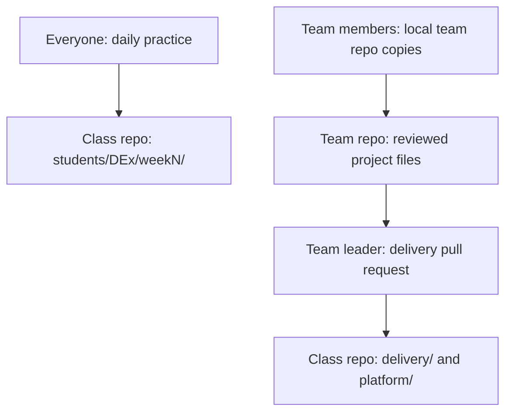

# Team Project Repo and the Delivery Folder

## 1. What We Are Doing

This guide helps you create your team project repository.
A repository, or repo, stores files and their Git history.
You will also learn how reviewed team work reaches the class repo.

You use two places:
- Your practice folder: `students/DEx/weekN/`.
- Your team project repo: the real project files.

Replace `DEx` with your student number, such as `DE12`.
Replace `N` with the current week number.

## 2. Why We Are Doing It

Your client is a fintech due-diligence company.
Its analysts check Indian companies using MCA, IBBI, MCA CDM, and RBI data.
Your team builds the Snowflake platform and the final dashboard.

The team repo holds the real project.
The class repo holds your practice and the reviewed delivery copies.
Only the team leader updates the class repo's `delivery/` and `platform/` folders.

This keeps the class repo up to date with the real project.
Review helps the team check files before sharing them.
This is new for most people. Go slowly.

## 3. What to Learn First (Prerequisites)

| Before you start | What you need |
|---|---|
| VS Code | Open a folder and use its terminal. |
| Git | Make a commit and understand a branch. |
| GitHub | Sign in and open a pull request. |
| Class repo | Have your fork and local clone. |
| Snowflake | Have the login details from the program lead. |
| Team | Know who leads the current week's delivery. |

A commit records a change in Git.
A branch keeps a set of changes separate during work.
A pull request asks someone to review a branch before merging it.
A remote is a named connection to another Git repo.
A clone is a local copy of a repo.

By the end, you can:
- Create and share a team repo.
- Save project files in the correct folders.
- Keep data and secrets out of Git.
- Send reviewed work to the class repo.
- Follow the team review routine.

## 4. Where to Find Resources

> **Where you work**
>
> Write, save, and commit files in VS Code.
> Run Git commands in the VS Code terminal.
> Use GitHub in your browser for repos and pull requests.
> Run SQL through the Snowflake extension or a Snowsight Workspace.
> Snowflake holds the data. VS Code holds your saved project files.

| Resource | Use it for |
|---|---|
| [docs/02-tools-setup.md](02-tools-setup.md) | Tool setup. |
| [docs/03-student-guide.md](03-student-guide.md) | Daily work and pull requests. |
| [docs/01-project-brief.md](01-project-brief.md) | Client needs and project scope. |
| [docs/04-week-map.md](04-week-map.md) | The 15-week order. |
| [docs/10-troubleshooting.md](10-troubleshooting.md) | Errors and setup problems. |
| [CONTRIBUTING.md](../CONTRIBUTING.md) | Class repo contribution rules. |
| [Git book](https://git-scm.com/book/en/v2) | Branches, remotes, and merging. |
| [GitHub docs](https://docs.github.com) | Repos and pull requests. |
| [Snowflake extension docs](https://docs.snowflake.com/en/user-guide/vscode-ext) | VS Code connection steps. |
| [dbt docs](https://docs.getdbt.com) | dbt Core setup in W12. |
| [Airflow docs](https://airflow.apache.org/docs/) | Airflow in W14. |

Search keywords: `git remote`, `git clone`, `pull request`, `merge conflict`, `Snowflake VS Code`.

## 5. Step-by-Step Guide

Work on one task, one file, and one commit at a time.
Follow [docs/03-student-guide.md](03-student-guide.md).
Use the task ID in task commit messages and pull request titles.
Never squash-merge.

### 5.1 Two places for your work

Everyone commits practice work daily.
Put every practice file inside `students/DEx/weekN/`.
The team repo holds the files that build the real project.

Each member can have a local copy of the team repo.
The leader copies reviewed work into the class repo.
Other members do not update class `delivery/` or `platform/`.



1. Open your class repo for individual practice.
2. Save practice files under `students/DEx/weekN/`.
3. Commit each completed practice task.
4. Open your team repo for real project work.
5. Send project changes through a team pull request.
6. Let the leader deliver the reviewed files.

> **Check it worked**
>
> You can identify which repo is open in VS Code.
> Practice files are in your own week folder.
> Project files are in the team repo.

### 5.2 Create the team project folder in VS Code

One person creates the shared team repo first.
The other members clone that repo.
Do not create separate GitHub repos for the same team project.

1. Open VS Code.
2. Choose **File > Open Folder**.
3. Create a new folder named `due-diligence-platform`.
4. Open that folder.
5. Open the VS Code terminal.
6. Run `git init`.
7. Create `README.md`.
8. Add this starter text.

```markdown
# Due Diligence Platform

## Purpose
Support due diligence on Indian companies.

## Team
Record the team members and this week's roles.

## Folder guide
Describe each project folder.

## Setup
Record setup steps without secrets.

## How to run
Record the reviewed steps as you build them.

## Milestones
Record progress for W1, W6, W7, W9, W11, W12, W13, and W15.

## Handover
Record the final run instructions and known limits.
```

9. Create `.gitignore`.
10. Add these lines.

```gitignore
data/
.env
.venv/
profiles.yml
target/
dbt_packages/
logs/
*.csv
*.pdf
```

11. Create `.env.example`.
12. Add comments describing needed settings without real credentials.
13. Review the files with `git status`.
14. Stage the starter files.

```bash
git add README.md .gitignore .env.example
```

15. Make the first commit.

```bash
git commit -m "G0.4 create team project repo"
```

16. Name the main branch.

```bash
git branch -M main
```

17. Create an empty repo on GitHub.
18. Copy its repository URL.
19. Add the remote using the command below.

Replace `TEAM_REPO_URL` with the copied URL.

```bash
git remote add origin TEAM_REPO_URL
```

20. Push the first commit.

```bash
git push -u origin main
```

21. Open the team repo on GitHub and invite every team member as a collaborator with **write** access.
    Look for the repo settings page for collaborators or access. Follow [GitHub docs](https://docs.github.com) if the menu names differ.
22. Tell each member to accept the invitation. They accept by email or on GitHub.
    They cannot clone and push until they accept.

If you get stuck:
- Read the error text in the VS Code terminal. It usually names the exact command and the reason.
- Check the remote with `git remote -v`. It must show the team repo URL.
- Read [docs/02-tools-setup.md](02-tools-setup.md) and [docs/10-troubleshooting.md](10-troubleshooting.md).
- Ask in Discord and paste the error text, the command you ran, and the folder path.

Use this recommended layout as the project grows.
The tree shows the final folder plan.

```text
due-diligence-platform/
├── README.md
├── .gitignore
├── .env.example
├── python/
├── sql/
│   ├── bronze/
│   ├── silver/
│   └── gold/
├── data/                  # local only, ignored
├── dbt/                   # W12
├── quality/               # W14
├── airflow/               # W14
│   └── dags/
├── dashboard/             # W15
└── docs/
```

Keep `dbt/` empty until W12.
Keep `quality/` and `airflow/` empty until W14.
Keep `dashboard/` empty until W15.
You can create these folders when their tool arrives.
Git does not include empty folders in a commit.
Add a README line when each new tool folder starts.

Other team members follow these steps:

1. Accept the GitHub invitation from the repo creator.
2. Copy the shared team repo URL.
3. Open a terminal in the folder that will hold the project.
4. Clone the repo.

```bash
git clone TEAM_REPO_URL
```

5. Open the cloned folder with **File > Open Folder**.

> **Check it worked**
>
> GitHub shows the README, `.gitignore`, and `.env.example`.
> `git remote -v` shows the shared team repo.
> Every member can open their local clone.

### 5.3 Connect the project to Snowflake from VS Code

Use the official Snowflake extension, published by Snowflake.
Exact menu names may change. Follow the extension docs if they differ.

**SQL connection**

1. Open the VS Code Extensions panel.
2. Install the official extension with the Snowflake badge.
3. Sign in using the account identifier and username provided.
4. Follow the cohort's sign-in method.
5. For password sign-in, set up an authenticator app at first login. Complete MFA when you sign in.
6. Open the first-query SQL file you created for task G0.3 in W1: `students/DEx/week1/sql/G0.3_first_query.sql`.
   Use that same file and that same full path. Do not create new project SQL yet.
7. Select the assigned role and warehouse.
8. Run **Snowflake: Execute All Statements** from the Command Palette.

Do not add project SQL under `sql/bronze/`, `sql/silver/`, or `sql/gold/` yet.
Those folders wait for the weeks whose tasks need them, starting in W2 with the database and schema tasks.
When those tasks arrive, save the SQL files there.

Then use names beginning with `01_`, `02_`, and later numbers.
The numbers show the intended run order.
Keep the final working SQL in the saved file.
Work in your own schema and use `LIMIT` while exploring.

You can also run saved SQL in Snowsight > Projects > Workspaces.
Select the role and warehouse there before running it.

If you get stuck:
- Read the error message in VS Code. A failed sign-in or MFA message tells you which step failed.
- Check that you picked the assigned role and warehouse at the top of the SQL file.
- Open [docs/02-tools-setup.md](02-tools-setup.md) and [docs/10-troubleshooting.md](10-troubleshooting.md), and read the [Snowflake extension docs](https://docs.snowflake.com/en/user-guide/vscode-ext).
- Ask in Discord and paste the error text and the role and warehouse you used.

**Python connection in W11**

1. Save Python project scripts in `python/`.
2. Use the Snowflake Python connector.
3. Keep local environment settings in ignored `.env`.
4. Use the key-pair or PAT method set by the program lead.

Never paste a password into code.
Keep private keys on your laptop and out of Git.
Ask the program lead if script login fails with an MFA message.

**dbt Core in W12 (preview only)**

Do not run these commands in W1.
This is a short preview of what comes in W12.
Before you run any dbt command, finish the W12 dbt Core setup first. That setup does four things:
- Activate the project virtual environment `.venv` in the VS Code terminal: `source .venv/bin/activate` on macOS/Linux, or `.venv\Scripts\activate` on Windows.
- Install dbt Core with `pip install dbt-snowflake` inside that activated environment.
- Create the dbt project with `dbt init`, so the folder has a `dbt_project.yml`.
- Create and fill the connection profile in `~/.dbt/profiles.yml` with the cohort's login method.

Then:

1. Add the project files under `dbt/`.
2. Run the commands in the VS Code terminal from the dbt project folder, the folder that holds `dbt_project.yml`.
3. Check that `.venv` is still activated. Run `dbt run` in the VS Code terminal.
4. Run `dbt test` in the VS Code terminal.

Never commit `profiles.yml`.
For key-pair settings, check the docs page for the exact parameter spelling.
Search [Snowflake docs](https://docs.snowflake.com) for "Key-pair authentication and key-pair rotation".
For sign-in changes, search "Planning for the deprecation of single-factor password sign-ins".

dbt Projects on Snowflake is an optional extra in Workspaces.
This cohort uses dbt Core by default.

**Airflow in W14**

1. Add Airflow project files under `airflow/`.
2. Save DAG files under `airflow/dags/`.
3. Add the Airflow folder description to the README.

A DAG describes the tasks and their run order.

> **Check it worked**
>
> Your first-query SQL file is saved in your practice folder.
> You can run it with your assigned Snowflake access.
> Local connection secrets remain outside Git.

### 5.4 Team leader routine: update the class repo

Do this weekly after the team reviews its project work.
Run these Git commands inside your local class repo.
Here, `origin` is your class fork and `upstream` is the class repo.
Check them with `git remote -v` before starting.
If `upstream` is missing, follow `docs/03-student-guide.md`.

1. Check for unfinished local changes with `git status`.
2. Finish any current work before changing branches.
3. Switch to the main branch with `git switch main`.
4. Pull the class updates with `git pull upstream main`.
5. Create the delivery branch with `git switch -c delivery_weekN`.

Replace `N` with the current week number.
For W6, the branch name is `delivery_week6`.

6. Copy the reviewed files using the mapping below.

| Team repo source | Class repo destination |
|---|---|
| `docs/`, discovery files | `delivery/discovery/` |
| `docs/`, design files and diagrams | `delivery/design/` |
| `dashboard/` | `delivery/dashboard/` |
| `docs/`, presentation and handover files | `delivery/presentation/` |
| `sql/bronze/` | `platform/raw/` |
| `sql/silver/` | `platform/staging/` |
| `sql/gold/` | `platform/marts/` |
| `quality/` | `platform/quality/` |
| `airflow/` | `platform/orchestration/` |
| `dbt/` | `platform/dbt/` |
| `python/`, reviewed raw-load scripts | `platform/raw/` |
| `python/`, reviewed transformation scripts | `platform/staging/` or `platform/marts/`, by purpose |
| `README.md`, the tool and run instructions for a tool folder | a named `README.md` inside the same destination, for example `platform/dbt/README.md` or `delivery/dashboard/README.md` |

`platform/raw/` holds code and definitions, not downloaded raw data.
Copy only the files needed for the delivery.
Never copy data files, `.env`, private keys, or `profiles.yml`.
When the team README gains tool or run instructions, copy that part into the matching named README at the destination. The destination README explains how that folder is used.

7. Review the copied files. Start with `git status` to see the new and changed files.
   `git diff` shows changes to tracked files only. It does not show the contents of newly copied files that Git does not track yet, so you may think you reviewed them when you did not.
   Open each new file in VS Code and read it.
8. Check the file list with `git status`.
9. Complete the checklist below.
10. Stage the delivery files with `git add delivery/ platform/`.
    The copied README files sit inside `delivery/` or `platform/`, so this command includes them. If you copied a README to another path, add it by name, for example `git add path/to/README.md`.
11. Review all staged contents with `git diff --cached`. This is the review that shows every new file in full.
12. Commit with the command below.

Replace `TASK_ID` with the task ID of the work you deliver, for example the week's task ID from the task list.
Replace `N` with the week number.

```bash
git commit -m "TASK_ID deliver reviewed team files for week N"
```

13. Push with `git push -u origin delivery_weekN`.
14. Open a pull request to the class repo.
15. Put the same task ID at the start of the pull request title, then describe the delivered files in the pull request body.
16. Wait for review before merging.

Before every delivery pull request:
- [ ] The team has reviewed the source files.
- [ ] The files match the current team project.
- [ ] Each file is in the correct destination.
- [ ] The team README tool and run instructions have a named README at the destination.
- [ ] No data files or secrets are included.
- [ ] No `.env`, private keys, or `profiles.yml` are included.
- [ ] The staged changes contain only intended delivery work.
- [ ] Every new file was opened in VS Code and `git diff --cached` was reviewed.
- [ ] The README explains any newly added tool.
- [ ] The pull request title starts with the task ID and describes what changed.

> **Check it worked**
>
> The pull request shows only reviewed delivery changes.
> The class repo receives the update after review and merge.
> The merge does not squash the commits.

### 5.5 Team member routine

Work in your local team repo.
Replace `YOUR_BRANCH` and `path/to/file` with your branch and file names.

1. Check your working files with `git status`.
2. Finish current work before switching branches.
3. Switch with `git switch main`.
4. Pull with `git pull origin main`.
5. Create a branch with `git switch -c YOUR_BRANCH`.
6. Make one small change.
7. Review it with `git diff`.
8. Stage it with `git add path/to/file`.
9. Commit it with the task ID and a short action.
10. Push with `git push -u origin YOUR_BRANCH`.
11. Open a pull request inside the team repo.
12. Ask the leader to review it.
13. Address the review comments.

> **Check it worked**
>
> Your pull request targets the team repo.
> The leader can review the changes before merging.

### 5.6 When you are stuck or a merge conflict appears

A merge conflict means Git needs help choosing the final file content.

1. Read the error and run `git status`.
2. Ask the leader or reviewer to compare the affected changes with you.
3. Agree on the final content. Decide together what the file must say. Do not edit yet.
4. Open the file in VS Code and remove the conflict markers: `<<<<<<<`, `=======`, `>>>>>>>`. Keep only the agreed content.
5. Save the file.
6. Stage each resolved file by name, for example `git add path/to/file`. Do this for every file Git listed as conflicted.
7. Check `git status`. It must show no unresolved conflicts.
8. Follow the instruction Git prints to finish the merge. For example, Git may ask you to run `git commit` to complete the merge.

Use `docs/10-troubleshooting.md` when you need more help.
Share the error text and file path when asking in Discord.
Remove secrets from anything you share.

> **Check it worked**
>
> The file contains the agreed content.
> `git status` shows no unresolved conflicts.

### 5.7 Roles per week

| Role | Weekly responsibility |
|---|---|
| Leader | Reviews team work and opens the class delivery pull request. |
| Reviewer | Checks changes, file locations, and missing explanations. |
| Scribe | Records decisions, sources, and run notes in `docs/`. |

1. Choose the week's leader.
2. Choose the week's reviewer.
3. Choose the week's scribe.
4. Record the roles in the README.
5. Rotate roles the following week where possible.

Only the current leader updates class `delivery/` and `platform/`.

> **Check it worked**
>
> Everyone knows their role.
> The README names the current week's roles.

## 6. What to Commit

Use this milestone checklist for the team repo.

- [ ] **W1, repo created:** README, `.gitignore`, and safe `.env.example` exist.
- [ ] **W1:** every team member was invited with write access and accepted before cloning.
- [ ] **W1, Discovery Brief:** reviewed discovery files are in `docs/`.
- [ ] **W6, First Snowflake Load:** load SQL and first-load notes exist.
- [ ] **W6:** notes explain the repeatable load and row-count checks.
- [ ] **W7, Star Schema Design:** reviewed design files and diagrams exist.
- [ ] **W9, Star Schema Design:** reviewed design files and diagrams exist.
- [ ] **W11, SCD2 Build:** build files and notes explain how history is kept.
- [ ] **W12, First Snowflake Load:** load SQL and first-load notes exist.
- [ ] **W13, SCD2 Build:** build files and notes explain how history is kept.
- [ ] **W15, Project Handover:** dashboard, presentation, and handover files exist.
- [ ] **W15:** the README explains setup, run order, and known limits.
- [ ] No milestone includes committed data files or secrets.
- [ ] The leader has opened the reviewed class delivery pull request, with the task ID in the title.
- [ ] Delivery changes have received review before merging.
