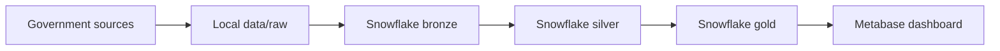

# Week 11 - History that survives

**Data Sprint 1 - Week 11 of 15. Theme: apply a month of changes without destroying last month's truth, then write the technical brief**

## 1. What We Are Doing

This week you learn to keep history when data changes. You detect what changed between two monthly snapshots and apply the changes without overwriting last month's truth. You also practise parallel downloads, connect Python to Snowflake with no password in code, and write the technical brief with a platform architecture diagram.

Task groups:
- Group 1 - Slowly Changing Dimensions (SCD2) [MILESTONE]: Tasks 1-3 (`S10.1`, `S10.2`, `S10.3`).
- Group 2 - Parallel Downloads: Tasks 4-5 (`P10.1`, `P10.2`).
- Group 3 - Python and Snowflake Together: Tasks 6-7 (`P11.1`, `P11.2`).
- Group 4 - Technical Brief [MILESTONE]: Tasks 8-9 (`D1.1`, `D1.2`).

## 2. Why We Are Doing It

The client checks Indian companies for due diligence. Analysts need answers about what was true at a point in time. A due diligence answer that reads today's table can be wrong for a past date. "S10 SCD2 Build" is the client's core requirement and the hardest logic in the sprint. Expect it to take longer than you think. Expect to get it wrong once before you get it right.

"D1 Technical Brief" is the written plan that the platform build in weeks 12 to 14 executes against. This week's skills protect history, make the pipeline faster, keep credentials safe, and give the build a map.

This is the first SCD2 milestone of the sprint. You build it here by hand, in SQL. In week 13 you build it again in dbt, on top of what you learn now. So the logic you write this week is not thrown away, it becomes the reference.

## 3. What to Learn First (Prerequisites)

### Before this week: what you must already have

Check every line before you start.

| You must already have | From |
|---|---|
| Three RoC ZIP files, unzipped into `data/raw/mca/`, with the download date noted | Week 2 |
| Practice tables in your own Snowflake schema: `RAW_MCA_<ROC>` for each RoC file, `RAW_IBBI_SAMPLE`, `RAW_MCA_PREV`, and the proper stage plus `COPY INTO` load of them | Weeks 3 and 6 |
| A `.venv` virtual environment in the repo, and the habit of activating it | Week 2 |
| Your retry decorator and your `requests` script | Week 7 |
| Your logging setup and your `argparse` script | Week 8 |
| Your IBBI PDF extractor | Week 9 |
| Your week 10 SQL: joins, CTEs, window functions, and the dimension table you named `dim_company` (the S9 tasks) | Week 10 |
| Your week 8 pipeline flow diagram, which Task 9 extends | Week 8 |

**If something is missing:** open that week's `problem_statement.md` in your own folder and redo the short step. If you are still stuck, ask in the class channel. Do not start week 11 with a missing table.

### By the end of this week you can

- Detect exactly what changed between two monthly snapshots
- Apply those changes with MERGE so old versions are closed, not overwritten
- Answer "what was this company's status on 1 March" and get March's answer, not today's
- Download files in parallel, and say why threads help here and not everywhere
- Connect Python to Snowflake with no password anywhere in the code
- Write the technical half of the discovery brief, with a platform architecture diagram

### Core concepts to review first

- SCD2 means Slowly Changing Dimensions Type 2. You keep old versions with `valid_from`, `valid_to`, and `is_current`.
- Change detection uses a join between this month's table and last month's table, matched on CIN.
- `MERGE` uses `WHEN MATCHED` and `WHEN NOT MATCHED` blocks.
- A point-in-time query finds the row that was open on a chosen date.
- Threads help with download work that mostly waits. The GIL limits what threads can do for number crunching.
- The Snowflake Python connector connects Python to Snowflake. Secrets come from `.env`.
- A technical brief and a Mermaid architecture diagram are part of the delivery work.

## 4. Where to Find Resources

### Where you work

- **VS Code** is your home base. You write, save and commit every file here.
- **Snowflake (Snowsight in your browser)** is where SQL runs. Open Snowsight > Projects > Workspaces, create or open a SQL file there, and set role `STUDENT_ROLE`, warehouse `STUDENT_WH`, and your own database and your own schema (the program lead gave you the names). When the SQL works, make sure the saved `.sql` file in VS Code has the final working version.
- **The VS Code terminal** is where Git and Python commands run, with `.venv` active.
- Snowsight asks for a second sign-in step (MFA) when you log in with a password. Set it up at first login if you have not.
- Every path below starts with `students/DEx/week11/...`. Replace `DEx` with your own number, for example `DE12`.
- Git steps are not repeated every week. See `docs/03-student-guide.md`.

### Docs for this week

| If you need... | Open |
|---|---|
| Git commands, branches, pull requests | `docs/03-student-guide.md` |
| The client story and the four data sources | `docs/01-project-brief.md` |
| A word you do not know | `docs/08-glossary.md` |
| Help with a broken tool | `docs/10-troubleshooting.md` |
| What a tool is for | `docs/11-tools-and-technology.md` |

### Your week in order

| Step | Learn first | Time | Then do |
|---|---|---|---|
| **1** | Kimball article "Slowly Changing Dimensions" (kimballgroup.com), Type 2 part only, skip Type 3 and Type 6; then Kudvenkat "Part 69 Merge in SQL Server" (watch the idea, not the SSMS clicks) | 40 min + 30 min | Tasks 1-3 (S10.1, S10.2, S10.3) |
| **2** | Real Python "Speed Up Your Python Program With Concurrency", threading section and the GIL part; Corey video #124: Python Threading Tutorial | 45 min | Tasks 4-5 (P10.1, P10.2) |
| **3** | Snowflake docs "Python Connector" (search that exact title); Corey video #146: Securely Manage Passwords and API Keys with DotEnv | 40 min | Tasks 6-7 (P11.1, P11.2) |
| **4** | Re-read your own week 1 brief in `students/DEx/week1/`, and `docs/01-project-brief.md` | 20 min | Tasks 8-9 (D1.1, D1.2) |
| **5** | Nothing new. Bring your own results from Tasks 1-9 | - | Cohort review |

**Cohort review this week:** SCD2 walkthrough, point in time proof, risk list.

### Search keywords if you get stuck

- `Snowflake MERGE`
- `SCD2 valid_from valid_to is_current`
- `Python ThreadPoolExecutor downloads GIL`
- `Snowflake Python connector .env`
- `Snowflake key-pair authentication`
- `Mermaid flowchart`

## 5. Step-by-Step Guide

How to work: do one task, write one file, make one commit. Then open a pull request. See `docs/03-student-guide.md`. Read each task fully before you start. This is new for most people. Go slowly.

**How your tasks are numbered.** The letter tells you the kind of task: B = Business and Delivery, S = SQL and Data Modeling, P = Python, D = Data Platform, A = Architecture diagrams. The number before the dot is the task group. The task ID goes in your commit message and your pull request title, for example `S10.2 scd2 merge`.

### Group 1 - Slowly Changing Dimensions (SCD2) [MILESTONE]

Foundation link: Kudvenkat "Part 69 Merge in SQL Server" and the window functions from week 10.

**What SCD2 means, in plain words.** Your `dim_company` table must remember the past. When a company's details change, you do not overwrite the old row. You close the old row with an end date and you add a new row with a start date. That way you can answer "what was the status on 1 March" because the March row still exists.

You add these columns to `dim_company` if you do not have them yet: `valid_from` (the day this version became true), `valid_to` (the day it stopped being true, empty if it is still true), and `is_current` (`Y` or `N`).

**A tiny example.** Last month the snapshot had two companies:

- `CIN_1`, ALPHA LTD, status ACTIVE
- `CIN_2`, BETA LTD, status ACTIVE

This month ALPHA LTD shows status STRIKE OFF. BETA LTD did not change. After the MERGE, `dim_company` has **three** rows:

| cin | company_name | status | valid_from | valid_to | is_current |
|---|---|---|---|---|---|
| CIN_1 | ALPHA LTD | ACTIVE | 2024-05-01 | 2026-02-28 | N |
| CIN_1 | ALPHA LTD | STRIKE OFF | 2026-03-01 | (empty) | Y |
| CIN_2 | BETA LTD | ACTIVE | 2024-05-01 | (empty) | Y |

The old ALPHA row is closed, the new one is open, and there is no gap and no overlap between them. BETA LTD keeps one open row.

**About your two snapshots.** Real monthly snapshots arrive this week. If they are unavailable, use the table you have for "this month" and a "previous month" practice copy, built the same way as in week 3. If you have two RoC downloads from two different dates, use those two files instead.

#### Task 1 - Detect the changes (ID `S10.1`)

##### 1. What We Are Doing

You write a SQL query in VS Code that finds what changed between this month's table and last month's practice table, matched on CIN. You run it in Snowflake. The objective is to name every kind of change before you apply it. Where you work: write the file in VS Code, run it in Snowflake.

##### 2. Why We Are Doing It

You cannot apply changes before you can name them. Analysts ask "what moved this month", and this query is the honest answer. It is the first half of the client's core requirement.

##### 3. What to Learn First

- Kimball article "Slowly Changing Dimensions" on https://www.kimballgroup.com. Read the Type 2 part only, about 40 minutes. Skip Type 3 and Type 6.
- If the self-join feels shaky, re-watch Kudvenkat "Part 14 Self join" (20 min).

##### 4. Where to Find Resources

- Kimball article "Slowly Changing Dimensions" on https://www.kimballgroup.com. Type 2 part only, about 40 minutes.
- Kudvenkat "Part 14 Self join" (20 min).
- Search keywords: `Snowflake self join`, `SQL change detection CIN`, `NULL in join comparison`.

##### 5. Step-by-Step Guide

1. In VS Code, right-click your week folder > New Folder, make `students/DEx/week11/sql/s10/`. Right-click that folder > New File, make `01_change_detection.sql`.
2. In Snowflake, open Snowsight > Projects > Workspaces and open a SQL file. Set role `STUDENT_ROLE`, warehouse `STUDENT_WH`, your own database and schema. Paste the starter below and fill the TODOs.
3. Join this month's table to last month's table on CIN. Then flag each kind of change you care about: status, authorised capital, paid-up capital, address, state.
4. Count how many companies changed for each kind of change, and write the numbers in `students/DEx/week11/sql/s10/notes.md`.

**Starter skeleton (change the names to match your own tables):**

```sql
-- Change detection: this month vs last month, matched on CIN
-- TODO 1: replace the two table names with your own
-- TODO 2: decide how to treat CINs that exist only in one side
-- TODO 3: add the other columns you compare
-- TODO 4: count the changes per change type

SELECT
    cur.cin,
    prev.status AS old_status,
    cur.status  AS new_status
FROM your_schema.raw_mca_roc1 AS cur
LEFT JOIN your_schema.raw_mca_prev AS prev
    ON cur.cin = prev.cin
WHERE cur.status <> prev.status   -- think: what happens when a side is NULL?
LIMIT 100;
```

If you get stuck: read the Snowflake error text first. Search `Snowflake self join NULL` or open `docs/10-troubleshooting.md`. Ask in the class channel with the SQL and the full error text.

How to think about it: A change is not only a different status. Decide which columns matter for due diligence, then compare each one. For CINs on one side only, decide if they are new companies or missing data.

##### 6. What to Commit

- [ ] `students/DEx/week11/sql/s10/01_change_detection.sql`
- [ ] `students/DEx/week11/sql/s10/notes.md`

Done when:
- [ ] The query runs without error.
- [ ] You have an answer for each kind of change.
- [ ] You know how many rows are new CINs, not changes.
- [ ] You wrote the counts for each change type in `students/DEx/week11/sql/s10/notes.md`.

Commit message: `S10.1 change detection between two snapshots`

#### Task 2 - Apply the changes with MERGE (ID `S10.2`)

##### 1. What We Are Doing

You write a MERGE statement in VS Code and run it in Snowflake on a test copy of `dim_company`. The MERGE closes changed rows with an end date and inserts new version rows. The objective is to load a new month without losing last month's truth. Where you work: write the file in VS Code, run it in Snowflake.

##### 2. Why We Are Doing It

This is the client's core requirement. The platform must load a new month without losing last month's truth, because due diligence work is about what was true at a point in time.

##### 3. What to Learn First

- Kudvenkat "Part 69 Merge in SQL Server", about 30 minutes. Watch for the idea only.
- Snowflake MERGE uses the same `WHEN MATCHED` and `WHEN NOT MATCHED` blocks.
- Search the Snowflake docs for "MERGE" when you write the real statement.

##### 4. Where to Find Resources

- Kudvenkat "Part 69 Merge in SQL Server" (30 min).
- Snowflake docs at https://docs.snowflake.com. Search for "MERGE".
- Search keywords: `Snowflake MERGE WHEN MATCHED`, `SCD2 merge SQL`, `idempotent MERGE`.

##### 5. Step-by-Step Guide

1. In VS Code, create `students/DEx/week11/sql/s10/02_scd2_merge.sql`.
2. In Snowflake, open Snowsight > Projects > Workspaces and open a SQL file.
3. Set role `STUDENT_ROLE`, warehouse `STUDENT_WH`, your database and schema.
4. Create a test copy: `CREATE TABLE dim_company_test AS SELECT * FROM dim_company;`
5. Count its rows: `SELECT COUNT(*) FROM dim_company_test;`
6. Write the count in `students/DEx/week11/sql/s10/notes.md`.
7. Write the MERGE on `dim_company_test`, never on the real table. Close changed rows with an end date. Then insert a new open version for each changed company after closing its previous version. `WHEN NOT MATCHED` inserts brand new companies.
8. Run it. Then run it a second time with the same input and count rows again. Check the three correctness checks below.
9. Write both counts and what you saw in `students/DEx/week11/sql/s10/notes.md`.

**Starter skeleton (use your own column names):**

```sql
MERGE INTO dim_company_test AS tgt
USING (
    -- TODO: the rows that changed between this month and last month
    SELECT
        cin,
        company_name,
        status
        -- TODO: add the columns you compare
    FROM your_schema.raw_mca_roc1
) AS src
ON tgt.cin = src.cin           -- TODO: add the condition that finds only the OPEN row
WHEN MATCHED THEN
    UPDATE SET valid_to = '2026-02-28', is_current = 'N'   -- TODO: use real dates and real logic
WHEN NOT MATCHED THEN
    INSERT (cin, company_name, status, valid_from, valid_to, is_current)
    VALUES (src.cin, src.company_name, src.status, CURRENT_DATE(), NULL, 'Y');

-- TODO: after this MERGE closes each changed row, insert a new open version
-- for that CIN (new valid_from, NULL valid_to, is_current = 'Y').
-- WHEN NOT MATCHED already inserts brand new companies.
-- All three correctness checks below must pass.
```

If you get stuck: check that the `ON` condition finds only the open row. Read the Snowflake error text and search `Snowflake MERGE WHEN MATCHED`. Ask in the class channel with your MERGE, the before count, and the after count.

How to think about it: The match must find only the open row. If the `ON` condition matches closed rows too, you will reopen or overwrite history.

##### 6. What to Commit

- [ ] `students/DEx/week11/sql/s10/02_scd2_merge.sql`
- [ ] `students/DEx/week11/sql/s10/notes.md`

Done when:
- [ ] The MERGE runs on the test copy.
- [ ] You have before and after row counts in notes.
- [ ] You have run it twice and can say what the second run did.
- [ ] All three correctness checks below pass.

Commit message: `S10.2 scd2 merge with before and after counts`

#### Task 3 - Answer a point in time question (ID `S10.3`)

##### 1. What We Are Doing

You write one SQL query in VS Code and run it in Snowflake. The query returns the status on 1 March 2026 for three companies from your test history. The objective is to prove your history is usable. Use three clearly labelled simulated changes with recorded snapshot dates. Use real companies only when two dated source snapshots establish their changes. Where you work: write in VS Code, run in Snowflake.

##### 2. Why We Are Doing It

Analysts ask "what was this company's status on 1 March". A plain read of today's table answers with today's status, which is the wrong answer. This query proves your history is usable.

##### 3. What to Learn First

- Nothing new. Re-read your own week 10 (S9.4) query for 10 minutes to remember the date filters you already wrote.

##### 4. Where to Find Resources

- Your own week 10 (S9.4) query.
- Search keywords: `SQL point in time SCD2`, `valid_from valid_to query`, `Snowflake date filter`.

##### 5. Step-by-Step Guide

1. In VS Code, create `students/DEx/week11/sql/s10/03_point_in_time.sql`.
2. In Snowflake: Snowsight > Projects > Workspaces. Set role `STUDENT_ROLE`, warehouse `STUDENT_WH`, your database and schema.
3. Pick three companies from `your_schema.dim_company_test`. Use three clearly labelled simulated changes with recorded snapshot dates. Use real companies only when two dated source snapshots establish their changes. Put their CINs in the query and record the snapshot dates in the query comments.
4. Write one query that returns the status on 1 March 2026 for each of the three.
5. Add a comment line per company: the snapshot dates you used, what the query returns, and what today's table would wrongly return.

**Starter skeleton:**

```sql
-- Point in time: status on 1 March 2026
-- Use simulated changes clearly labelled with snapshot dates,
-- or real companies only when two dated source snapshots show the change.
SELECT
    cin,
    company_name,
    status,
    valid_from,
    valid_to
FROM your_schema.dim_company_test
WHERE cin IN ('TODO_CIN_1', 'TODO_CIN_2', 'TODO_CIN_3')
  AND -- TODO: the row that was open on 2026-03-01
ORDER BY cin, valid_from;
```

If you get stuck: check your date filter uses `valid_from` and `valid_to` correctly. Search `SQL point in time SCD2` or open `docs/10-troubleshooting.md`. Ask in the class channel with the query and the result you expected.

How to think about it: A point-in-time answer uses the row that was open on that date, not `is_current`. Add a comment for what today's table would wrongly return, so a reader sees the difference.

##### 6. What to Commit

- [ ] `students/DEx/week11/sql/s10/03_point_in_time.sql`

Done when:
- [ ] You get exactly one row per CIN for 1 March 2026.
- [ ] Each of the three has a recorded change and snapshot dates: either simulated and clearly labelled, or real and shown by two dated source snapshots.
- [ ] You can explain in one sentence why the old row was needed.

Commit message: `S10.3 point in time status query for three companies`

**Run Task 2 on a test copy first, every time.** A MERGE with the match condition slightly wrong will silently overwrite history, and the whole point of the week is that history survives.

**Three checks that tell you Task 2 is correct:**
- Run it twice with the same input. The second run must change nothing. If row counts grow, it is not idempotent (safe to run again).
- Exactly one row per CIN has an open end date.
- A company that changed status has two rows, with no gap and no overlap between the old end date and the new start date.

### Group 2 - Parallel Downloads

#### Task 4 - Download in parallel (ID `P10.1`)

##### 1. What We Are Doing

You write a Python script in VS Code that downloads files in a sequential loop, then in parallel with `ThreadPoolExecutor`. You run it in the VS Code terminal and compare the times. The objective is to see the difference on the same files and the same machine. Where you work: VS Code for the file, VS Code terminal to run it.

##### 2. Why We Are Doing It

Some sources have many files and each download mostly waits. Waiting in parallel saves an hour of the pipeline's night, and the client gets fresh data earlier.

##### 3. What to Learn First

- Real Python article "Speed Up Your Python Program With Concurrency" on https://realpython.com. Read the threading section and the part about the GIL, about 45 minutes. Skip the multiprocessing and asyncio deep parts.
- Corey video #124: Python Threading Tutorial, for the idea of threads in Python.
- Reuse your retry decorator and your timeout from week 7. Do not rewrite them.

##### 4. Where to Find Resources

- Real Python article "Speed Up Your Python Program With Concurrency" on https://realpython.com. Threading section and GIL part, about 45 minutes.
- Corey video #124: Python Threading Tutorial (in the Corey Schafer playlist).
- Search keywords: `Python ThreadPoolExecutor`, `concurrent.futures`, `GIL I/O bound`.

##### 5. Step-by-Step Guide

1. In VS Code, create `students/DEx/week11/python/p10/parallel_download.py`.
2. Reuse your retry decorator and your timeout from week 7. Do not rewrite them.
3. Write one sequential loop, time it. Then write a `ThreadPoolExecutor` version, time it. Same files, same machine.
4. Keep the pool small (3 or 4 workers). Save your file timings in `students/DEx/week11/python/p10/notes.md`.
5. Run it from the repo root, with your virtual environment active:
   `python students/DE12/week11/python/p10/parallel_download.py` (use your own number).

**Starter skeleton:**

```python
import time
from concurrent.futures import ThreadPoolExecutor

URLS = []  # TODO: direct download URLs confirmed in the browser; ask the program lead for suitable URLs if the source has no stable direct links

def fetch_one(url):
    # TODO: reuse the retry decorator and the timeout from week 7
    pass

def fetch_sequential(urls):
    start = time.perf_counter()
    for url in urls:
        fetch_one(url)
    return time.perf_counter() - start

def fetch_parallel(urls, workers=3):
    start = time.perf_counter()
    # TODO: ThreadPoolExecutor with a small pool
    return time.perf_counter() - start

if __name__ == "__main__":
    # TODO: run both versions, print both times
    # TODO: keep the pool small, do not open twenty connections
    pass
```

If you get stuck: check that `.venv` is active and that you run the script from the repo root. Read the Python traceback and search `Python ThreadPoolExecutor`. Ask in the class channel with the traceback and your pool size.

How to think about it: Time both versions on the same files and same machine. Keep the pool small. A download mostly waits, so the timing should show the difference.

##### 6. What to Commit

- [ ] `students/DEx/week11/python/p10/parallel_download.py`
- [ ] `students/DEx/week11/python/p10/notes.md`

Done when:
- [ ] Both versions run and print a time.
- [ ] The parallel time is in your notes.
- [ ] Your pool size and timeout are visible in the code.

Commit message: `P10.1 parallel RoC download with timings`

#### Task 5 - Explain why threads help (ID `P10.2`)

##### 1. What We Are Doing

You work in VS Code only. You add three sentences to your notes that explain why threads help downloads and why they do not help number crunching. The objective is to explain the GIL in your own words.

##### 2. Why We Are Doing It

A tool you cannot explain is a tool you will misuse. The client team will ask why the download step is parallel and the transform step is not.

##### 3. What to Learn First

- Nothing new. Skim the GIL section of the Real Python article again, 10 minutes.

##### 4. Where to Find Resources

- Real Python article "Speed Up Your Python Program With Concurrency" on https://realpython.com. GIL section.
- Search keywords: `GIL I/O bound`, `Python threads CPU bound`, `why threads help downloads`.

##### 5. Step-by-Step Guide

1. Open `students/DEx/week11/python/p10/notes.md`.
2. Add a heading `## Why threads help here` and write three sentences.
3. Answer these questions while you write: Where does a download spend most of its time? Where does a number-crunching job spend most of its time? What does the GIL let only one thread do at a time? Which Python feature did you use for the parallel version?

If you get stuck: keep it to exactly three sentences and name the GIL. Search `GIL I/O bound` or read the Real Python GIL section again. Ask in the class channel and paste your three sentences.

How to think about it: Answer the four questions in the task in your own words. Do not copy sentences from the article.

##### 6. What to Commit

- [ ] `students/DEx/week11/python/p10/notes.md`

Done when:
- [ ] You have exactly three sentences.
- [ ] The GIL is named.
- [ ] A reader who never saw your code understands the difference.

Commit message: `P10.2 why threads help for downloads and not for number crunching`

**On Task 4:** be a good citizen. Do not open twenty connections to a government website. Keep the pool small, keep the timeout, and keep the retry from week 7.

### Group 3 - Python and Snowflake Together

**How your script logs in.** Your Python script must never hold a password. The program lead tells you which login method the cohort uses: key-pair authentication or a Programmatic Access Token (PAT). You keep the secret in a local file that Git ignores, and the script reads it. For key-pair, the private key file stays on your laptop and is never committed. For a PAT, the token stays in `.env` and is never committed. If a script fails with an MFA (multi-factor) message, do not add a password to the code. Ask the program lead. Search https://docs.snowflake.com for "Planning for the deprecation of single-factor password sign-ins" and follow the program lead's instructions for the cohort's login configuration.

#### Task 6 - Connect Python to Snowflake (ID `P11.1`)

##### 1. What We Are Doing

You work in VS Code to write a Python script and a `.env` file. You run the script in the VS Code terminal. The script connects to Snowflake and counts rows in one raw table, with no password in the code. The objective is to connect safely and log a real row count.

##### 2. Why We Are Doing It

From now on Python checks the platform, not only the source files. Connecting without a password in the code is the rule for every script you write for this client.

##### 3. What to Learn First

- Search the Snowflake docs for "Python Connector" and read the connect example, about 30 minutes.
- Corey video #146: Securely Manage Passwords and API Keys with DotEnv, 15 minutes. Optional: #54 or #55, Hiding Passwords and Secret Keys in Environment Variables.
- Know that `.env` must be in the repo root and must be listed in `.gitignore`.
- For key-pair, the public key is registered by the program lead or Snowflake admin on your Snowflake user. The private key stays on your laptop and is never committed. The connector can use `private_key_file`.
- For PAT, follow the program lead's instructions. Never paste the token into code.

##### 4. Where to Find Resources

- Snowflake docs at https://docs.snowflake.com. Search for "Python Connector" and read the connect example.
- Corey video #146: Securely Manage Passwords and API Keys with DotEnv (15 min).
- Search keywords: `snowflake-connector-python`, `python-dotenv`, `Snowflake Python connector connect example`, `Snowflake key-pair authentication`, `Snowflake Programmatic Access Token`.

##### 5. Step-by-Step Guide

1. In the VS Code terminal, with `.venv` active, install the two packages: `pip install snowflake-connector-python python-dotenv`
2. Make `.env` in the **repo root** (not in your week folder) with these lines and your real values:
   ```
   SNOWFLAKE_ACCOUNT=...
   SNOWFLAKE_USER=...
   SNOWFLAKE_ROLE=STUDENT_ROLE
   SNOWFLAKE_WAREHOUSE=STUDENT_WH
   SNOWFLAKE_DATABASE=...
   # For key-pair only: path to your private key file. Never commit the key.
   SNOWFLAKE_PRIVATE_KEY_PATH=...
   # For PAT only: the token from the program lead. Never commit .env.
   SNOWFLAKE_PAT=...
   ```
3. Confirm `.env` is already listed in `.gitignore`. If it is not, tell the program lead before you go further.
4. Ask the program lead which login method the cohort uses: key-pair or PAT.
5. If the cohort uses key-pair: make an RSA key pair with `openssl` on your laptop. The private key stays on your laptop and is never committed. Give the public key to the program lead or Snowflake admin. The admin registers it with `ALTER USER <your_user> SET RSA_PUBLIC_KEY = '<public_key>';`
6. If the cohort uses PAT: create the token the way the program lead tells you, and store it only in `.env`.
7. In VS Code, create `students/DEx/week11/python/p11/snowflake_count.py` using the skeleton below. Run the row count on one raw table and log the result with `logging.info`.
8. Run from the repo root: `python students/DE12/week11/python/p11/snowflake_count.py`
9. If your login fails with an MFA message, do not add a password to the code. Ask the program lead which method the cohort uses (key-pair or PAT). Search https://docs.snowflake.com for "Planning for the deprecation of single-factor password sign-ins" and follow the program lead's instructions for the cohort's login configuration.

**Starter skeleton:**

```python
import os
import logging
import snowflake.connector
from dotenv import load_dotenv

load_dotenv()  # reads .env in the repo root
logging.basicConfig(level=logging.INFO)

# Key-pair example. If the cohort uses a PAT, follow the program lead's
# connector configuration. Never use a password in code.
conn = snowflake.connector.connect(
    account=os.getenv("SNOWFLAKE_ACCOUNT"),
    user=os.getenv("SNOWFLAKE_USER"),
    private_key_file=os.getenv("SNOWFLAKE_PRIVATE_KEY_PATH"),
    role=os.getenv("SNOWFLAKE_ROLE"),
    warehouse=os.getenv("SNOWFLAKE_WAREHOUSE"),
    database=os.getenv("SNOWFLAKE_DATABASE"),
)

# TODO: run the row count query on one raw table
# TODO: log the number with logging.info
# TODO: close the connection
```

If you get stuck: check that `.env` is in the repo root and the variable names match the skeleton. Search `Snowflake Python connector connect example` or read `docs/10-troubleshooting.md`. Ask in the class channel with the error text, but do not paste your secret.

How to think about it: Secrets come from the environment. The code reads names, not values. If you see a password in code, stop and fix it before you commit.

##### 6. What to Commit

- [ ] `students/DEx/week11/python/p11/snowflake_count.py`
- [ ] `students/DEx/week11/python/p11/notes.md` (add a short line that no secret is in any committed file)

Done when:
- [ ] The script prints or logs a real row count.
- [ ] No secret value appears in any file Git tracks.
- [ ] `git status` does not list `.env`.

Commit message: `P11.1 Snowflake connector with credentials from .env`

#### Task 7 - Write the load verifier (ID `P11.2`)

##### 1. What We Are Doing

You write a Python script in VS Code that compares a file row count with a table row count. You run it in the VS Code terminal. The script exits with code 1 when the numbers differ. The objective is a verifier that a pipeline can trust. Where you work: VS Code for the file, VS Code terminal to run it.

##### 2. Why We Are Doing It

A load is only finished when file rows equal table rows. This script becomes an Airflow task in week 14, and Airflow reads the exit code to decide if the pipeline continues.

##### 3. What to Learn First

- Nothing new. You use the connector from Task 6 and the logging from week 8.
- Optional: Corey video #52: Logging Basics, if you want to check the logging idea again.

##### 4. Where to Find Resources

- Your Task 6 script, `students/DEx/week11/python/p11/snowflake_count.py`.
- Your week 8 logging notes.
- Search keywords: `Python sys.exit code`, `logging mismatch`, `Airflow exit code`.

##### 5. Step-by-Step Guide

1. In VS Code, create `students/DEx/week11/python/p11/load_verifier.py`.
2. The script takes a file row count and a table row count. It compares them and exits with code 1 when they differ.
3. Log both numbers on every run, match or mismatch.
4. Test both paths: one run with matching numbers, one run with a fake mismatch.
5. Run from the repo root: `python students/DE12/week11/python/p11/load_verifier.py`

**Starter skeleton:**

```python
import sys
import logging

logging.basicConfig(level=logging.INFO)

def verify(file_rows, table_rows):
    # TODO: return True when the two numbers match
    pass

if __name__ == "__main__":
    file_rows = 0    # TODO: real count from the file
    table_rows = 0   # TODO: real count from the table, via the connector
    if not verify(file_rows, table_rows):
        # TODO: log both numbers, then exit with a failure code
        sys.exit(1)
```

If you get stuck: test one matching run and one fake mismatch. Search `Python sys.exit code` or read your week 8 logging notes. Ask in the class channel with both log lines and the exit code you saw.

How to think about it: The exit code is the signal. Logging is for humans. The exit code is for Airflow.

##### 6. What to Commit

- [ ] `students/DEx/week11/python/p11/load_verifier.py`

Done when:
- [ ] A matching run exits with code 0.
- [ ] A mismatch run exits with code 1.
- [ ] Both numbers are logged.

Commit message: `P11.2 load verifier exits non-zero on mismatch`

**On Task 6:** read your own diff before you push. A committed secret is the one mistake in this sprint that cannot be quietly undone. See `docs/10-troubleshooting.md`, Git section, if it happens.

**On Task 7:** the exit code is the point. Airflow decides whether the pipeline continues by reading it, so a script that prints "mismatch" and exits successfully is worse than useless in week 14.

### Group 4 - Technical Brief [MILESTONE]

#### Task 8 - Write the technical brief (ID `D1.1`)

##### 1. What We Are Doing

You work in VS Code only. You write a one-page technical brief for the engineer who inherits the pipeline. You use the outline below and name the real risks you have met. The objective is to record technical risks and explain how the pipeline will handle them.

##### 2. Why We Are Doing It

Week 1's brief was for the client. This one is for the engineer who inherits the pipeline. It names the real risks, so the build in weeks 12 to 14 knows the risks to handle.

##### 3. What to Learn First

- Nothing new. Re-read your own week 1 brief in `students/DEx/week1/` and the four sources in `docs/01-project-brief.md`, about 20 minutes.

##### 4. Where to Find Resources

- `docs/01-project-brief.md`.
- Your own week 1 brief in `students/DEx/week1/`.
- Search keywords: `technical brief risks data pipeline`, `data source cadence`, `CIN join risk`.

##### 5. Step-by-Step Guide

1. In VS Code, make the folder `students/DEx/week11/discovery/` and the file `technical_brief.md`.
2. Use the outline below. Keep it to one page.
3. Name risks you have actually hit in weeks 3 to 10. Think about: the PDF layout shifting, four spellings of one state, CINs that do not join across sources, a source with no stable download URL.
4. Answer these questions while you write: What format does each of the four sources arrive in? How often does each one change? Which risk would stop the pipeline first? What would you check first on a Monday morning?

**Starter outline:**

```markdown
# Technical brief

## 1. The four sources
| Source | What it is | Format | How often it changes | How we get it |
|---|---|---|---|---|

## 2. Top three technical risks
### Risk 1 -
- What can go wrong:
- What we do about it:

## 3. Open questions
```

If you get stuck: re-read your week 1 brief. Check every source has a format and a cadence. Ask in the class channel and paste your outline, not a general question.

How to think about it: Write for the next engineer. Name risks you actually hit. If you cannot remember, open your old notes.

##### 6. What to Commit

- [ ] `students/DEx/week11/discovery/technical_brief.md`

Done when:
- [ ] All four sources are described with format and cadence.
- [ ] Exactly three risks are named.
- [ ] Every risk is one you met yourself.
- [ ] It fits on one page.

Commit message: `D1.1 technical brief with sources and top three risks`

#### Task 9 - Draw the platform architecture (ID `D1.2`)

##### 1. What We Are Doing

You work in VS Code only. You write a Markdown file with a Mermaid diagram that extends your week 8 pipeline flow diagram. The diagram shows every hop from a government website to the analyst's dashboard, and where the automated checks sit.

##### 2. Why We Are Doing It

The diagram is the map the platform build follows. It shows every hop from a government website to the analyst's dashboard, and where the automated checks sit.

##### 3. What to Learn First

- Nothing new. Look at the Mermaid basics on https://mermaid.js.org for 15 minutes, then re-open your week 8 pipeline flow diagram.

##### 4. Where to Find Resources

- Mermaid basics on https://mermaid.js.org (15 min).
- Your week 8 pipeline flow diagram.
- Search keywords: `Mermaid flowchart`, `Mermaid subgraph`, `Mermaid GitHub`.

##### 5. Step-by-Step Guide

1. In VS Code, make the folder `students/DEx/week11/design/` and the file `platform_architecture.md`.
2. Extend your week 8 diagram. Do not start over.
3. Show every component: the four sources, the load, bronze, silver, gold, dbt, and the Metabase dashboard.
4. Mark where the platform rotation's work lands, and where each automated check runs (dbt tests, Great Expectations, Airflow).
5. If the diagram and the brief disagree, the brief wins and the diagram is wrong. Fix the diagram.

**Starter skeleton:**



If you get stuck: check the code block is marked `mermaid` and view the file on GitHub. Search `Mermaid flowchart syntax` or open https://mermaid.js.org. Ask in the class channel with the diagram code.

How to think about it: Draw the data path first as boxes and arrows. Then add the checks where they run. If the brief and diagram disagree, fix the diagram.

##### 6. What to Commit

- [ ] `students/DEx/week11/design/platform_architecture.md` (embed the diagram in a ```mermaid block)

Done when:
- [ ] Every hop from source to dashboard is on the diagram.
- [ ] The three automated checks each have a place.
- [ ] It agrees with your technical brief.

Commit message: `D1.2 platform architecture diagram in Mermaid`

## 6. What to Commit

End of week checklist:
- [ ] Task 1 - change detection with counts per change type
- [ ] Task 2 - the MERGE, tested on a copy, with before and after row counts and the three correctness checks
- [ ] Task 3 - point in time answers for three companies with recorded changes (simulated and labelled, or real with two dated snapshots)
- [ ] Tasks 4-5 - parallel downloads with both timings, and the GIL explanation
- [ ] Tasks 6-7 - connector script with credentials from the environment, and a verifier that exits non-zero on mismatch
- [ ] Tasks 8-9 - the technical brief and the platform architecture diagram
- [ ] At least one teammate's pull request reviewed with a real comment
- [ ] You can explain SCD2 out loud, using one company from your own data as the example

**If you are short on time, cut in this order:** Task 5 (P10.2), then Task 7 (P11.2). Never cut Tasks 1-3 (S10). It is the milestone, the client's core requirement, and week 13 rebuilds it in dbt on top of what you learn here.

**Team project repo.** If you are the team leader, copy or sync the latest reviewed project files from your team's local project repository into the class repo `delivery/` or `platform/` folder. Everyone keeps practice files in `students/DEx/week11/`. Only the team leader updates the class repo `delivery/` and `platform/` folders, by opening a pull request.

Check that each task has its commit and pull request. See `docs/03-student-guide.md`.

Next: `students/DEx/week12/problem_statement.md`.
