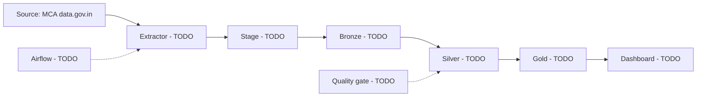

# Week 15 - Present and hand over

**Data Sprint 1 · Week 15 of 15 · Theme: make the work visible to the client, then hand it to a stranger**

## 1. What We Are Doing

This week you present the platform and hand it over. You build a dashboard, write a client talk, draw the final architecture, write a runbook and README, run a clean handover test, and archive the project. Work through the task groups in this order:

- Group 1 - Dashboard: Tasks 1-2 (`B6.1`, `B6.2`)
- Group 2 - Stakeholder Delivery: Tasks 3-4 (`B7.1`, `B7.2`)
- Group 3 - Final Architecture for Handover: Task 5 (`A4.1`)
- Group 4 - Project Handover [MILESTONE]: Tasks 6-9 (`B8.1`, `B8.2`, `D10.1`, `D10.2`)

Read this whole file before you start. This week has the most work in the sprint. Plan the order you will work in before you start. Then work through the task groups in order.

## 2. Why We Are Doing It

The client is a fintech due-diligence company. Its analysts check Indian companies: is the company real and active, was it ever in insolvency, how does it compare to its state, and what was the interest-rate backdrop. Your work is only useful when the client can see it, use it, and run it after you leave.

**The milestones this week:** **B8 Project Handover** and **D10 Project Handover.** D10.1 is the real test: a clean checkout, a fresh schema, and only the runbook to guide you. Every gap you find is a gap you fix.

## 3. What to Learn First (Prerequisites)

### Before this week: what you must already have

| What you must already have | If it is missing |
|---|---|
| **Gold tables** built in your earlier weeks. The layer contract was week 13, the builds came after. Check your week 13 and week 14 notes for the exact database and gold schema names. | Run your marts again, or ask the program lead which schema holds your gold tables. |
| **Your week 1 system map and your week 13 architecture diagram.** | Rebuild a simple version from the folders in your repo. Simple is fine, a wrong picture is not. |
| **The Airflow DAG and the quality gate** from earlier weeks, running end to end. Task 8 depends on it. | If the DAG fails now, write it down today. |
| **A Metabase login** from the program lead. Metabase is hosted by the program, so you do not install anything. | Ask on day 1, not on day 6. |
| **A working local setup:** repo cloned, `.venv` active, `.env` present but never committed. | Read `docs/02-tools-setup.md`. |

### By the end of this week you can

- Build a dashboard a non-technical analyst can read without you present
- Present to a client with zero tool names, including what the platform cannot tell them
- Draw the final architecture diagram for the handover
- Hand over a pipeline someone else can run from a clean checkout

### Core concepts to review first

- Gold layer: the clean, modeled tables that the dashboard reads.
- SCD2: a way to keep status history, not only the current status.
- Plain language: labels and talk for an analyst who is not a data engineer.
- Mermaid flowchart: a simple diagram written in a Markdown code block.
- Runbook: the steps someone else follows to run and check the pipeline.
- Clean checkout: a fresh copy of the repo with no local changes.

## 4. Where to Find Resources

> **Where you work (read once, use all week)**
>
> - **VS Code** is your home base. You write, save and commit every file here, inside your cloned repo.
> - **Snowflake (Snowsight in the browser)** is where SQL runs. Open Snowsight > Projects > Workspaces. Paste your `.sql` file, pick role and warehouse, run it.
> - **VS Code terminal** is where Git and Python run. Activate `.venv` first (you did this in week 2).
> - **Browser** is where Metabase and GitHub live.
> - `DEx` is your own number, for example DE12. So `students/DEx/week15/...` means `students/DE12/week15/...` for you. Data files and secrets never go into Git.

> **How your script logs in**
>
> This week you mostly read and check, but any Python script or dbt run needs a Snowflake login.
> The program lead sets the login method for the cohort: key-pair authentication or a Programmatic Access Token (PAT).
> MFA is a second sign-in step. Never paste a password into code. Never commit a private key, a token, or `.env`.
> If a script login fails with an MFA message, stop and ask the program lead.
> See https://docs.snowflake.com and search for "Planning for the deprecation of single-factor password sign-ins". For cohort login settings, ask the program lead.

> **dbt note (only if you need to re-run models this week)**
>
> The cohort default is dbt Core. It runs in the VS Code terminal.
> Activate `.venv`.
> If needed, run `pip install dbt-snowflake`.
> The connection profile is in `~/.dbt/profiles.yml`. The profile name must match `profile:` in `dbt_project.yml`. Never commit this file.
> Run `dbt debug`, then `dbt run`, then `dbt test`.
> Optional extra: dbt Projects on Snowflake in a Workspace. See https://docs.snowflake.com/en/user-guide/data-engineering/dbt-projects-on-snowflake .

> **Team project repo**
>
> Practice files stay in `students/DEx/week15/`.
> If you are the team leader, copy this week's reviewed files into the class repo `delivery/` or `platform/` folder, then open a pull request. See `docs/15-team-project-repo-and-delivery.md`.

### Docs map

| If you need... | Read this |
|---|---|
| Platform rules before you touch `platform/`, `airflow/`, `quality/`, or `delivery/` | `docs/07-platform-and-cicd-guide.md` and `docs/06-team-roles.md` |
| Git commands (add, commit, push, pull request) | `docs/03-student-guide.md` |
| The meaning of a word you do not know | `docs/08-glossary.md` |
| Help when a tool is broken | `docs/10-troubleshooting.md` |
| What a tool is for | `docs/11-tools-and-technology.md` |
| Team project repo and delivery rules | `docs/15-team-project-repo-and-delivery.md` |
| Snowflake login for scripts (key-pair or PAT) | https://docs.snowflake.com and search for "Planning for the deprecation of single-factor password sign-ins"; ask the program lead for cohort login settings |

Git is explained in `docs/03-student-guide.md`. It is not repeated here.

### How your tasks are numbered

`B` = Business and Delivery. `S` = SQL and Data Modeling. `P` = Python. `D` = Data Platform. `A` = Architecture diagrams. The task ID goes in the commit message and in the pull request title. Example: `B6.1 build Metabase dashboard views`.

### Your week in order

| Step | LEARN (time) | DO |
|---|---|---|
| **1** | Metabase docs, sections "Asking questions" and "Dashboards" at https://www.metabase.com/docs/latest/ (about 60 min) | Tasks 1-2 - four views, plain language labels |
| **2** | Nothing new. Reuse your week 14 notes on what the data can and cannot show (10 min) | Tasks 3-4 - the presentation script, the Q&A log |
| **3** | Mermaid flowcharts at https://mermaid.js.org (about 30 min). Re-read your week 1 system map and week 13 diagram (20 min) | Task 5 - the final architecture |
| **4** | The runbook checklist inside Task 6 (15 min). Optional: Fundamentals of Data Engineering, Chapter 3 | Tasks 6-9 - runbook, final README, clean run, archive |
| **5** | - | Final review: client presentation, handover walkthrough |

### Search keywords if you get stuck

- Metabase dashboard
- Metabase question filters
- Mermaid flowchart syntax
- data runbook handover
- clean checkout handover test

## 5. Step-by-Step Guide

Work one task, one file, one commit. Work inside your own week folder. Git and pull requests are explained in `docs/03-student-guide.md`. This is new for most people. Go slowly.

### Group 1 - Dashboard

#### Task 1 - Build the dashboard (ID `B6.1`)

##### 1. What We Are Doing

Build the Metabase dashboard with four views. The views read only gold tables. Save the dashboard description in VS Code. Where you work: Browser (Metabase) first, then VS Code to save the file.

##### 2. Why We Are Doing It

The client's analysts must read company status, insolvency and capital without calling you. For due diligence on Indian companies, this dashboard is the product they pay for.

##### 3. What to Learn First

- Metabase docs at https://www.metabase.com/docs/latest/ , sections "Asking questions" and "Dashboards".
- About 60 minutes.
- Skip the setup and admin pages: the program hosts Metabase and gives you a login.

##### 4. Where to Find Resources

- Metabase docs at https://www.metabase.com/docs/latest/ , sections "Asking questions" and "Dashboards". About 60 minutes.
- Search keywords: "Metabase dashboard", "Metabase question", "Metabase filters".

##### 5. Step-by-Step Guide

1. Log in to Metabase with the details the program lead gave you.
2. Select the Metabase connection the program lead configured for your gold schema. It points to role `STUDENT_ROLE`, warehouse `STUDENT_WH`, and your gold schema. If the connection is missing, ask the program lead. Do not create a new database connection.
3. Build four views: (a) company status counts by state, (b) insolvency events by quarter, (c) capital distribution by business activity, (d) a company search that shows current status plus status history.
4. Save each view with a clear name, then put all four on one dashboard.
5. In VS Code, right-click the folder `students/DEx/week15/delivery` > New File > `dashboard_definition.md`. Write one short paragraph per view: what data it uses, what it answers, how it is filtered.
6. If you are the team leader, create `dashboard/` in the team repo and add one README line for it. Copy the reviewed dashboard files there. When you mirror to the class repo, put dashboard files in `delivery/dashboard/`.

If you get stuck: read the error text first. Search the Metabase docs for "dashboard" or "question". Check the connection name and gold schema, or ask in Discord with the error text.

**On Task 1:** the company search view shows the value of the whole sprint's SCD2 work, the status history. Current status plus the history that led to it, in one place, is the whole point of the project.

**Build on gold tables only.** A dashboard reaching into bronze or silver breaks the layer contract you wrote in week 13, and it breaks quietly.

##### 6. What to Commit

- [ ] `students/DEx/week15/delivery/dashboard_definition.md`
- [ ] Four views exist.
- [ ] All four views read gold tables only.
- [ ] The dashboard is saved with a name the client understands.
- [ ] The description file is committed.
- [ ] Commit message: `B6.1 build Metabase dashboard views`

#### Task 2 - Write the plain language labels (ID `B6.2`)

##### 1. What We Are Doing

Write plain language labels and short explanations for the four dashboard views. Make the labels in Metabase match the file. Where you work: VS Code.

##### 2. Why We Are Doing It

The analyst reading the dashboard is not a data engineer. Labels decide whether they trust the numbers or guess at them.

##### 3. What to Learn First

Nothing new. You use what you learned in Task 1.

##### 4. Where to Find Resources

- Nothing new. Use the Metabase docs from Task 1 and your own dashboard.
- Search keywords: "dashboard labels", "plain language labels", "data dictionary labels".

##### 5. Step-by-Step Guide

1. Open `students/DEx/week15/delivery/dashboard_definition.md`.
2. For each of the four views, write the label as it will appear on the dashboard (short, no abbreviations) and one sentence of explanation.
3. Answer these questions in the same file:
   - What question does this view answer for an analyst?
   - What is the unit: companies, events, rupees, or quarters?
   - What is not included here, and where can the analyst find it?
   - Which date field drives the view, and how fresh is it?
4. Set the same labels inside Metabase so the dashboard and the file match.

If you get stuck: read your own view names again. Search the Metabase docs for "dashboard". Ask in Discord with the label that is unclear.

How to think about it: write for an analyst who will not have you in the room.

##### 6. What to Commit

- [ ] Append to `students/DEx/week15/delivery/dashboard_definition.md`
- [ ] All four views have a label and a one-sentence explanation.
- [ ] The labels in Metabase match the file.
- [ ] The file is committed.
- [ ] Commit message: `B6.2 plain language labels for dashboard views`

### Group 2 - Stakeholder Delivery

#### Task 3 - Write the presentation script (ID `B7.1`)

##### 1. What We Are Doing

Write a five minute client presentation script. The script must use zero tool names and include a limits section. Where you work: VS Code.

##### 2. Why We Are Doing It

The client decides whether the platform is useful based on five minutes of talk. No tool names means no one in the room feels lost.

##### 3. What to Learn First

Nothing new. Read the plain language box below (3 min).

##### 4. Where to Find Resources

- Nothing new. Read the plain language box below (3 min).
- Search keywords: "client presentation data", "plain language data limits", "five minute presentation".

##### 5. Step-by-Step Guide

1. In VS Code, right-click `students/DEx/week15/delivery` > New File > `presentation_script.md`.
2. Write it for five minutes of speaking, around 600 to 700 words. Structure: what we built, what the data shows, what you should do with it, what the platform cannot tell you.
3. Use zero tool names. Not Snowflake, not dbt, not Airflow, not Metabase. Say "the platform", "the dashboard", "the data".
4. Answer these questions before you finish:
   - Which three numbers will you say out loud, and where does each one come from?
   - What decision does the client make after seeing the dashboard?
   - Which known limit will you say plainly, and why that one?
   - What do you want the client to do in the first week after handover?
5. Read it aloud once and cut anything you stumble over.
6. If you are the team leader, put the reviewed presentation files in the team repo and mirror them into the class repo `delivery/presentation/`.

If you get stuck: read the plain language box again. Search for "plain language data limits". Ask in Discord with the sentence you cannot say simply.

> **Plain language box: talking to a non-technical person**
> - No tool names. Say "the platform", "the data", "the dashboard".
> - Say what the data shows: which companies are active, which went into insolvency, how a state compares.
> - Say what to do with it: the decision the analyst makes after reading the dashboard.
> - Say what the platform guarantees: where the numbers come from, how often they refresh, what is out of scope.
> - Say the limits out loud. A client who finds a limit after handover stops believing the rest.

**On Task 3:** the limits section is the part that builds trust. Unmatched CINs (company IDs), a state whose data is thin, a source that updates quarterly and not monthly: say it plainly.

How to think about it: write for a client, not for your classmates or the program lead.

##### 6. What to Commit

- [ ] `students/DEx/week15/delivery/presentation_script.md`
- [ ] The script is about 600 to 700 words.
- [ ] It contains no tool names.
- [ ] It has a limits section.
- [ ] It is committed.
- [ ] Commit message: `B7.1 five minute client presentation script`

#### Task 4 - Rehearse and log the hard questions (ID `B7.2`)

##### 1. What We Are Doing

Ask a peer to play the client. Present from the script and log the three hardest questions and your answers. Where you work: Browser for the call, then VS Code for the log.

##### 2. Why We Are Doing It

A client will ask the question you hoped to avoid. Better to hear it from a peer now than from the client later.

##### 3. What to Learn First

Nothing new. You use what you learned in Task 3.

##### 4. Where to Find Resources

- Nothing new. Use the script from Task 3.
- Search keywords: "client Q&A log", "presentation rehearsal", "hard questions data".

##### 5. Step-by-Step Guide

1. Ask a peer to play the client. Give them the script and 10 minutes.
2. Present your script during the call. Keep the script open so you can read it.
3. Ask the peer for their three hardest questions. Write them down word for word.
4. In VS Code, create `students/DEx/week15/delivery/qa_log.md` and record for each question: the question, your answer, and whether the answer was solid or "I did not know".
5. For every "I did not know", add one line saying where the answer should live (dashboard, runbook, or limits section).

If you get stuck: ask the peer to repeat the question in simple words. Search for "presentation rehearsal". Ask in Discord with the question you could not answer.

How to think about it: a hard question is useful. It shows you which part of the handover needs one more sentence.

##### 6. What to Commit

- [ ] `students/DEx/week15/delivery/qa_log.md`
- [ ] Three hard questions are logged.
- [ ] Each question has an answer or an honest "I did not know".
- [ ] Each gap has a home written next to it.
- [ ] Commit message: `B7.2 rehearsal and hard questions log`

### Group 3 - Final Architecture for Handover

#### Task 5 - Draw the final architecture (ID `A4.1`)

##### 1. What We Are Doing

Draw the final architecture and final star schema for handover. Put the Mermaid block in a Markdown file. Where you work: VS Code. The diagram renders on GitHub.

##### 2. Why We Are Doing It

A stranger must see the whole path from the government sources to the dashboard in one picture, before reading any code.

##### 3. What to Learn First

- Mermaid flowcharts at https://mermaid.js.org , about 30 minutes.
- Re-read your week 1 system map and your week 13 architecture diagram, about 20 minutes.
- Skip the other Mermaid diagram types.

##### 4. Where to Find Resources

- Mermaid flowcharts at https://mermaid.js.org , about 30 minutes.
- Re-read your week 1 system map and week 13 architecture diagram, about 20 minutes.
- Search keywords: "Mermaid flowchart", "star schema diagram", "data pipeline diagram".

##### 5. Step-by-Step Guide

1. In VS Code, right-click `students/DEx/week15/delivery` > New File > `final_architecture.md`.
2. Draw the pipeline exactly as it runs today: sources, extractors, stages, bronze, silver, gold, the quality gate, Airflow, the dashboard.
3. Add the final star schema: facts, dimensions, and the keys that join them.
4. Update both pictures with everything that changed since week 13.
5. Starter skeleton:



6. Copy the finished diagram into `students/DEx/week15/delivery/runbook.md` in Task 6 and into the final README in Task 7.

If you get stuck: read the Mermaid error on GitHub. Search for "Mermaid flowchart syntax". Compare your diagram with the folders in your repo, or ask in Discord with the block that fails.

**On Task 5:** the diagrams must match what the code actually does. Compare both diagrams with the code and runbook. Fix any differences before handover.

How to think about it: draw what runs today, not what you planned in week 1.

##### 6. What to Commit

- [ ] `students/DEx/week15/delivery/final_architecture.md`
- [ ] The pipeline is drawn.
- [ ] The star schema is drawn.
- [ ] Both match the code.
- [ ] The same block appears in the runbook and the README.
- [ ] Commit message: `A4.1 final architecture for handover`

### Group 4 - Project Handover [MILESTONE]

#### Task 6 - Write the runbook (ID `B8.1`)

##### 1. What We Are Doing

Write the runbook. It must let the client's team refresh the data after you leave. Where you work: VS Code.

##### 2. Why We Are Doing It

The client's team must refresh the data after you leave. The runbook is the only thing they will have.

##### 3. What to Learn First

- Read the one-page template below, about 15 minutes.
- Optional: Fundamentals of Data Engineering, Chapter 3, for how teams hand over pipelines.

##### 4. Where to Find Resources

- Read the one-page template below, about 15 minutes.
- Optional: Fundamentals of Data Engineering, Chapter 3.
- Search keywords: "data runbook", "pipeline refresh steps", "row count check".

##### 5. Step-by-Step Guide

1. In VS Code, right-click `students/DEx/week15/delivery` > New File > `runbook.md`.
2. Start from this template and delete nothing. Put "unknown" where you do not know yet.

```
# Runbook - <project name>
## 1. What this platform does (3 lines)
## 2. Where things live (repo folders, database, schemas, role, dashboard link)
## 3. How to refresh each source
### 3.1 MCA Company Master Data (data.gov.in)
### 3.2 IBBI insolvency lists
### 3.3 MCA CDM state statistics
### 3.4 RBI policy rate (DBIE)
## 4. How to run the pipeline (order of commands, DAG names)
## 5. How to check a run worked (row counts, tests, dashboard freshness)
## 6. Five common failures and what to do
## 7. Who to contact for what
## 8. Where the documentation lives (links)
## 9. Known limits (what the platform cannot tell you)
```

3. For each source in section 3, write: where to get the file, where to save it locally, which command to run, and how to check the row count. Also write how to set up the environment (`.venv`, `.env`) and safe authentication before the first run. State where downloaded source files must be placed.
4. Paste the Mermaid diagram from Task 5 into section 2.
5. Write section 9 honestly. Unmatched CINs, thin states, quarterly sources, the RBI step series, and that the RBI file ends in 2024 (carry the last rate forward) all belong here.

If you get stuck: read the section you are writing. Search for "data runbook" or "pipeline refresh steps". Ask in Discord with the missing source name.

How to think about it: write for a stranger on their first day, not for yourself.

##### 6. What to Commit

- [ ] `students/DEx/week15/delivery/runbook.md`
- [ ] All nine sections exist.
- [ ] Each of the four sources has a refresh recipe and a check.
- [ ] Section 7 names a real contact.
- [ ] Commit message: `B8.1 write the runbook`

#### Task 7 - Write the final README (ID `B8.2`)

##### 1. What We Are Doing

Write the final README for the repo. It is the first file a stranger reads. Where you work: VS Code.

##### 2. Why We Are Doing It

The README is the first thing a stranger reads. It tells them what the project is and where to start.

##### 3. What to Learn First

Nothing new. You use what you learned in Task 6 and Task 5.

##### 4. Where to Find Resources

- Nothing new. Use the runbook from Task 6 and the diagram from Task 5.
- Search keywords: "README structure", "project handover README", "GitHub README links".

##### 5. Step-by-Step Guide

1. In VS Code, right-click `students/DEx/week15/delivery` > New File > `README_final.md`.
2. Use headings only at the start, then fill each one in two to four lines:

```
# <Project name>
## What this project is
## The question it answers for the client
## Where the data comes from
## How the repository is organised
## The architecture
## How to run it (link to the runbook)
## What is finished and what is not
## Known limits
## Who to contact
```

3. Keep every link working. Test each one by clicking it on GitHub after you push.
4. Keep your draft in `students/DEx/week15/delivery/README_final.md` and use it to update the team repo README. Only the team leader mirrors reviewed files into the class repo `delivery/`.

If you get stuck: click every link on GitHub. Search for "README structure". Ask in Discord with the link that fails.

How to think about it: a stranger reads the README before the code. Give them the shortest path to understand the project.

##### 6. What to Commit

- [ ] `students/DEx/week15/delivery/README_final.md`
- [ ] The team repo README is updated.
- [ ] Every heading is filled.
- [ ] The architecture diagram is embedded.
- [ ] All links open.
- [ ] The team repo README matches your draft.
- [ ] Commit message: `B8.2 final README for the repository`

#### Task 8 - Run the clean handover test (ID `D10.1`)

##### 1. What We Are Doing

Run the clean handover test. Use a fresh schema and a clean clone, and follow only the runbook. Where you work: VS Code to save the schema SQL, Snowflake (Snowsight > Projects > Workspaces) to run it, VS Code terminal to clone the clean copy, then VS Code to write the log.

##### 2. Why We Are Doing It

This is the only real proof that the handover works. If you need your memory to run the pipeline, the runbook is incomplete.

##### 3. What to Learn First

Nothing new. Re-read your runbook from Task 6, then close everything else.

##### 4. Where to Find Resources

- Nothing new. Re-read your runbook from Task 6.
- Search keywords: "clean checkout test", "fresh schema test", "handover runbook gaps".

##### 5. Step-by-Step Guide

1. In VS Code, create `students/DEx/week15/sql/handover_setup.sql` with this SQL: `CREATE SCHEMA IF NOT EXISTS <your_database>.<your_name>_handover_test;` Save the file. Then open Snowflake (Snowsight > Projects > Workspaces), choose role `STUDENT_ROLE` and warehouse `STUDENT_WH`, paste the SQL, and run it.
2. Before you run any pipeline step, use the runbook to configure every pipeline component to use your fresh test schemas: SQL, dbt profiles, and Airflow DAG settings. Verify that all outputs land in the fresh test schemas, not in your old schemas.
3. In the VS Code terminal, clone a clean copy outside your working folder: `git clone <your fork URL> /tmp/handover_test`
4. Open only the runbook. Do not open your week notes, your old chats, or the diagram file.
5. Follow the runbook from section 1 to the end, literally, including environment setup, safe authentication, source file placement, and the steps you know by heart.
6. Every time you use knowledge that is in your head and not in the file, stop and write a row in the table below before you continue.
7. Fix the runbook, commit, then run the whole thing again from a fresh schema. Record the second run.
8. Put the table and both run results in one log file.

| # | Runbook step | What I had to guess | Fix I made (commit) |
|---|---|---|---|
| 1 |  |  |  |
| 2 |  |  |  |
| 3 |  |  |  |

If you get stuck: read the runbook step again before you guess. Search `docs/03-student-guide.md` for clone and branch steps. Ask in Discord with the runbook step number and the error text.

**On Task 8:** follow the runbook literally, including the steps you know by heart. Every time you use knowledge that is in your head and not in the file, that is a gap, and it goes in the log before you fix it.

How to think about it: if you need memory to run the pipeline, the runbook is missing a step.

##### 6. What to Commit

- [ ] `students/DEx/week15/sql/handover_setup.sql`
- [ ] `students/DEx/week15/delivery/handover_test.md`
- [ ] The second run finishes from a fresh schema using only the runbook.
- [ ] Every gap row has a fix commit.
- [ ] Both runs are recorded with their result.
- [ ] Commit message: `D10.1 clean handover test fixes`

#### Task 9 - Archive the project (ID `D10.2`)

##### 1. What We Are Doing

Archive the project on GitHub. Close loose pull requests and check links, secrets, data, and generated files. Where you work: Browser (GitHub) first, then VS Code for any last fix.

##### 2. Why We Are Doing It

An archive with open pull requests and broken links looks unfinished, and the client reads it that way.

##### 3. What to Learn First

Nothing new. You use what you learned in Task 6 and Task 7.

##### 4. Where to Find Resources

- Nothing new. Use the runbook and the README from Tasks 6 and 7.
- Search keywords: "GitHub pull requests close", "repo secrets check", "documentation links check".

##### 5. Step-by-Step Guide

1. On GitHub, open the pull request list. Merge or close every open pull request. For each closed one, write the reason in a comment.
2. Check the final README links every document in the repo, including the runbook and the architecture diagram.
3. Check the repo has no secrets, no data files, and no generated files. Look for `.env`, `.csv`, `.zip`, `.pdf`.
4. Fix anything broken in VS Code, then open the final pull request titled `D10.2 Project handover`.

If you get stuck: read the GitHub error or warning. Search for "GitHub pull requests close". Ask in Discord with the pull request number.

##### 6. What to Commit

- [ ] No new file. Update `students/DEx/week15/delivery/runbook.md` or `students/DEx/week15/delivery/README_final.md` if this step finds a mistake.
- [ ] No pull request other than the final handover pull request is open.
- [ ] Every documentation link works.
- [ ] The repo holds no secrets or data.
- [ ] The `D10.2 Project handover` pull request is open.
- [ ] Commit message: `D10.2 archive the project for handover`

## 6. What to Commit

End of week checklist:

- [ ] Tasks 1-2 - four views on gold tables, each with a plain language label and explanation
- [ ] Tasks 3-4 - a script with zero tool names and a real limits section, plus three hard questions logged
- [ ] Task 5 - the final architecture and schema diagram, embedded in the runbook and the final README
- [ ] Tasks 6-7 - the runbook and the final README in the team repo
- [ ] Tasks 8-9 - clean run log with every runbook gap fixed, and the handover pull request
- [ ] Nothing secret, nothing large, nothing generated is in the repository

**If you are short on time, cut in this order:** Task 2 (B6.2), then Task 4 (B7.2), then Task 5's polish. Never cut Tasks 6, 8, or 9 (B8.1, D10.1, D10.2). The handover is the sprint's actual output.

When your week is ready, open a pull request to the class repo and follow the steps in `docs/03-student-guide.md`.

Next: Read `docs/00-START-HERE.md` once more, the section on what happens after week 15. Then re-read your own week 1 discovery brief. Compare your week 1 understanding with what you know now. Write down what you learned.
