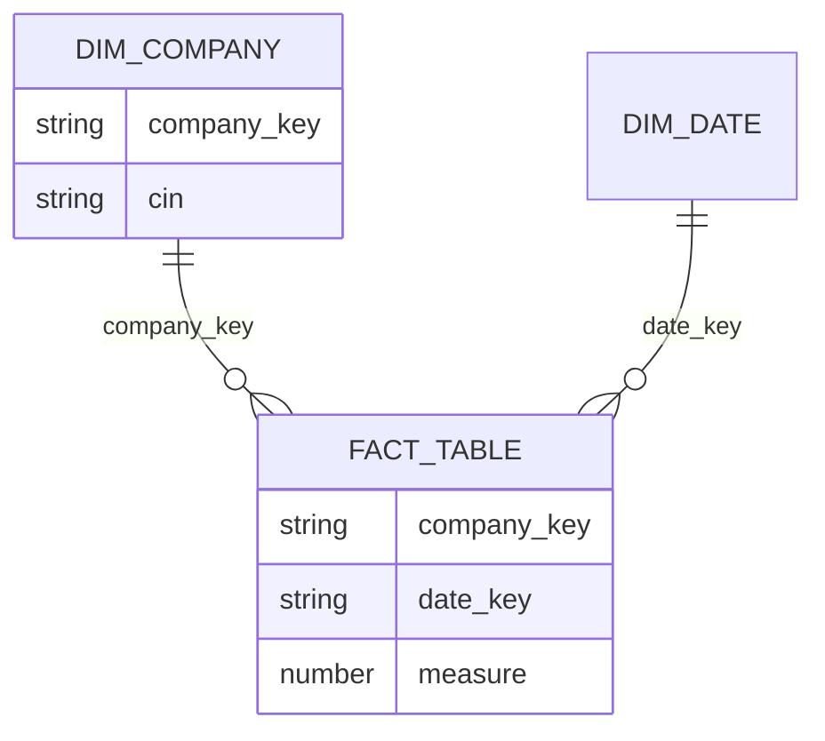
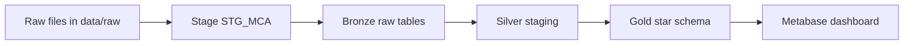

# Week 6 - First load, and the design begins

**Data Sprint 1 - Week 6 of 15 - Theme: get every file into Snowflake with counts that match, then start designing the gold layer**

## 1. What We Are Doing

This week you move from practice loads to a repeatable Snowflake load. You get every RoC (Registrar of Companies) CSV file into Snowflake and prove that the row counts match. Then you start the gold layer design: star schema ERD, grain statements, a modelling decision record and a pipeline flow diagram.

Read this whole file before you start. Then work through the task groups in order.

Task groups:
- Group 1 - First Snowflake Load [MILESTONE]: Tasks 1 to 3 (P3.1, P3.2, P3.3)
- Group 2 - Design Record, ERD and Architecture: Tasks 4 to 6 (B3.1, B3.2, B3.3)
- Group 3 - Pipeline Flow Diagram: Task 7 (A2.1)

## 2. Why We Are Doing It

The client uses the platform for due diligence on Indian companies. Analysts check if a company is real and active, if it was ever in insolvency, how it compares with its state, and the interest-rate background. If a load drops rows, every later count and every dashboard number is wrong. This week's load pattern is the pattern you use every month, for every file. The design work this week makes the gold layer clear before anyone builds it.

**The milestone this week:** **P3 First Snowflake Load.** Every difference between rows in the file and rows in the table is zero, or explained in writing. No exceptions, no rounding, no "almost the same".

## 3. What to Learn First (Prerequisites)

**Before this week: what you must already have**

| You must already have | From |
|---|---|
| Your cloned repo with `students/DEx/week1` to `week5` in it | weeks 1 to 5 |
| The three RoC CSV files, unzipped into `data/raw/mca/` | week 2, "Download your practice data" |
| Your Python row counter (tasks P1.1 to P1.3) and a working `.venv` | week 3 |
| Snowflake login with role `STUDENT_ROLE`, warehouse `STUDENT_WH`, your database and your own schema | week 1 setup |
| The practice kit tables in your schema: three `RAW_MCA_<ROC>` tables, `RAW_IBBI_SAMPLE`, `RAW_MCA_PREV` | week 3, Step 0 |
| Your week 5 SQL practice finished, using the same tables in `UNION ALL` | week 5 |

If something is missing, redo that task from that week first. If the table data is gone, run the week 3 Step 0 load again. Still stuck: `docs/10-troubleshooting.md`, then ask the program lead.

**By the end of this week you can**
- Load files into Snowflake and prove the row counts match
- Draw the star schema diagram and write the grain of each gold table
- Justify medallion layering, a star at gold, and why not Data Vault
- Draw the pipeline flow so a reviewer can see where each tool sits

**Core concepts to review first**
- ERD, star schema, fact table, dimension table and grain.
- Medallion layering.
- Mermaid `erDiagram` and `flowchart` basics.

## 4. Where to Find Resources

> **Where you work**
> - **VS Code** is your main place to work. You write, save and commit files here.
> - **Snowflake (Snowsight, in the browser)** is where you run SQL. Open Projects > Workspaces. Data lives there.
> - **VS Code terminal** is where you run Git and Python. Activate `.venv` first.
> - **Full paths use `DEx`.** Replace it with your own number, for example DE12.
> - Git basics, once: `docs/03-student-guide.md`.
> - Do not commit data files or secrets.

**How your tasks are numbered**

The letter in the ID tells you the task family. B = Business and Delivery, S = SQL and Data Modeling, P = Python and Data Platform, D = Data Platform, A = Architecture diagrams. The ID goes in your commit message and in your pull request title, for example `P3.1 create stage and file format`.

**Docs to open when you need them**

| You need | Where to look |
|---|---|
| Git commands and pull requests | `docs/03-student-guide.md` |
| Client story and data sources | `docs/01-project-brief.md` |
| A word you do not know | `docs/08-glossary.md` |
| A tool that is broken | `docs/10-troubleshooting.md` |
| What a tool is for | `docs/11-tools-and-technology.md` |

**Your week in order**

| Step | Learn first (exact resource and time) | Then do |
|---|---|---|
| **1** | Search the Snowflake docs for "COPY INTO <table>". Read the parts on stages and file formats. About 40 min. | Tasks 1 to 3 (P3.1, P3.2, P3.3) |
| **2** | Kimball "Dimensional Modeling Techniques", sections on fact tables, dimension tables and grain. About 30 min. | Tasks 4 and 5 (B3.1, B3.2) |
| **3** | Read the decision-record format, medallion layers and Data Vault comparison in `docs/11-tools-and-technology.md`. About 15 min. | Task 6 (B3.3) |
| **4** | Mermaid docs at https://mermaid.js.org, flowchart and erDiagram syntax. About 20 min. Re-read your week 1 system map. | Tasks 4 and 7 (B3.1, A2.1) |
| **5** | Nothing new. | Cohort review: load reconciliation numbers, design kickoff |

**Python this week: nothing new.** You reuse your week 3 row counter. No new videos.

**Search keywords if you get stuck**
- Snowflake COPY INTO <table>
- Snowflake CREATE STAGE
- Snowflake CREATE FILE FORMAT
- Snowflake upload local file internal stage
- Kimball dimensional modeling grain
- Mermaid erDiagram flowchart

## 5. Step-by-Step Guide

Work one task, one file, one commit. Then open a pull request to the class repo when the week is ready. See `docs/03-student-guide.md` for Git and pull request steps.

> **Team project repo:** only the team leader copies or syncs this week's reviewed files from the team repo into the class repo `delivery/` or `platform/` folder, then opens a pull request. Everyone keeps practice files in `students/DEx/week6/`.

### Group 1 - First Snowflake Load [MILESTONE]

> **This is week 3 done properly.** In week 3 you loaded practice data with the Snowsight wizard. That was a shortcut to get rows in fast. Now you use the repeatable way: internal stage, named file format, `COPY INTO`, then a row-count check. This is the pattern you will use every month, for every file.

> **Before Task 1: download the remaining RoC files**
> 1. Go to the Company Master Data catalog on https://data.gov.in.
> 2. Download the remaining RoC ZIP files. You already have three from week 2.
> 3. Unzip them into `data/raw/mca/`.
> 4. Record the download date in your notes. In Task 1 you create `students/DEx/week6/sql/p3/notes.md`; add the date there.

#### Task 1 - Create the stage and file format (ID `P3.1`)

##### 1. What We Are Doing
You create a named internal stage and a named CSV file format in your own Snowflake schema. You write the SQL in VS Code first, then run it in Snowflake (Snowsight).

##### 2. Why We Are Doing It
The due-diligence platform reloads MCA files every month. A named stage and a named file format mean every load uses the same settings, so a count that matched last month still matches this month.

##### 3. What to Learn First
- Search the Snowflake docs for "CREATE STAGE" and "CREATE FILE FORMAT".
- Read only the option lists. About 30 min.
- Skip anything about external stages and cloud storage for now.

##### 4. Where to Find Resources
- Search the Snowflake docs for "CREATE STAGE".
- Search the Snowflake docs for "CREATE FILE FORMAT".
- About 30 min.
- Search keywords: Snowflake CREATE STAGE, Snowflake CREATE FILE FORMAT.

##### 5. Step-by-Step Guide
1. In VS Code, create `students/DEx/week6/` in your cloned repo.
2. Inside `students/DEx/week6/`, create a folder `sql`, then a folder `p3` inside `sql`.
3. Inside `sql/p3/`, create `01_stage_and_format.sql`.
4. Put this starter in the file. Fill in your database and schema names where you see `<...>`. Use role `STUDENT_ROLE`, warehouse `STUDENT_WH`, your own database and your own schema.

```sql
USE ROLE STUDENT_ROLE;
USE WAREHOUSE STUDENT_WH;
USE DATABASE <your_database>;
USE SCHEMA <your_schema>;

CREATE STAGE IF NOT EXISTS STG_MCA
  COMMENT = 'internal stage for MCA RoC CSV files';

CREATE OR REPLACE FILE FORMAT FF_MCA_CSV
  TYPE = CSV
  SKIP_HEADER = 1
  FIELD_OPTIONALLY_ENCLOSED_BY = '"'
  -- TODO: add one or two more options from the docs
  ;
```

5. Open Snowsight in the browser, open a Workspace (Projects > Workspaces), create a SQL file, paste the file and run it.
6. Create `notes.md` in `sql/p3/`. Write one line for each option in your file format: what the option does and why you chose that value. `SKIP_HEADER = 1` means the first line of the CSV is a header, not data.
7. Run `SHOW STAGES;` and `SHOW FILE FORMATS;` in Snowsight to confirm both exist.

Save as: `students/DEx/week6/sql/p3/01_stage_and_format.sql` and `students/DEx/week6/sql/p3/notes.md`. `DEx` is your own number, for example DE12.

If you get stuck:
- Read the error message in Snowsight first.
- Search the Snowflake docs for "CREATE STAGE" or "CREATE FILE FORMAT".
- Ask in Discord and paste the full error text.

How to think about it: one option in a file format is a rule for every future load. Write the reason for each rule, not only the value.

##### 6. What to Commit
- [ ] `students/DEx/week6/sql/p3/01_stage_and_format.sql`
- [ ] `students/DEx/week6/sql/p3/notes.md`

Done when:
- [ ] The stage and the file format exist in your schema.
- [ ] `notes.md` explains every option in one line.
- [ ] The working SQL is saved in VS Code.

Commit message: `P3.1 create stage and CSV file format`

#### Task 2 - Load the first file (ID `P3.2`)

##### 1. What We Are Doing
You upload one RoC CSV to the stage and run `COPY INTO` to load it into a raw table. You also count the rows in the file and in the table. You work in VS Code to write SQL and run the row counter in the terminal, and in Snowflake (Snowsight) to upload the file and run the load.

##### 2. Why We Are Doing It
A due-diligence check is only as good as the rows behind it. If a load silently drops rows, every later count and every dashboard number is wrong.

##### 3. What to Learn First
- Search the Snowflake docs for "COPY INTO <table>" and read the load options. About 30 min.
- Search the Snowflake docs for uploading local files to an internal stage.
- Skip the bulk load tuning sections.

##### 4. Where to Find Resources
- Snowflake docs: search for "COPY INTO <table>". About 30 min.
- Snowflake docs: search for uploading local files to an internal stage.
- Search keywords: Snowflake COPY INTO, Snowflake upload local file internal stage, Snowflake ON_ERROR.

##### 5. Step-by-Step Guide
1. Get the CSV into the stage. Search `https://docs.snowflake.com` for "uploading local files to an internal stage", and follow the current steps for your stage `STG_MCA`. Upload one RoC CSV from `data/raw/mca/`. If the program lead gives you setup and connection instructions for the Snowflake CLI, you may use the CLI route. Do not use a CLI route without those instructions.
2. In `02_first_load.sql`, write a `CREATE TABLE IF NOT EXISTS RAW_MCA_<ROC>_W6` statement before the `COPY INTO`. Use the same columns as your week 3 practice table for that RoC. Open the week 3 table in Snowsight and copy its column list. This week 6 table must be separate and empty. Do not load into the week 3 practice table `RAW_MCA_<ROC>`. If you want to save typing, search the Snowflake docs for "CREATE TABLE LIKE".
3. In VS Code, create `students/DEx/week6/sql/p3/02_first_load.sql` inside your week folder. Starter:

```sql
USE ROLE STUDENT_ROLE;
USE WAREHOUSE STUDENT_WH;
USE DATABASE <your_database>;
USE SCHEMA <your_schema>;

CREATE TABLE IF NOT EXISTS RAW_MCA_<ROC>_W6 (
  <column definitions from your week 3 practice table>
);

COPY INTO RAW_MCA_<ROC>_W6
  FROM @STG_MCA
  FILES = ('<exact staged filename>.csv')
  FILE_FORMAT = (FORMAT_NAME = FF_MCA_CSV)
  -- TODO: add ON_ERROR and explain your choice in notes.md
  ;

SELECT COUNT(*) AS ROWS_LOADED FROM RAW_MCA_<ROC>_W6;
```

4. Run it in Snowsight. Read the output: it tells you the filename, rows parsed, rows loaded and any errors. `ON_ERROR` decides what happens when a row is bad. Record the filename, target table, rows parsed, rows loaded and errors from the `COPY INTO` result in `notes.md`. Read the `ON_ERROR` part in the page you read: search the Snowflake docs for "COPY INTO <table>".
5. Count the rows in the file. In the VS Code terminal, from the repo root, activate `.venv` (`source .venv/bin/activate`, or `.venv\Scripts\activate` on Windows), then run your week 3 row counter on the same CSV, for example `python students/DEx/week3/python/row_counter.py data/raw/mca/<file>.csv`. If your script takes a different argument, use whatever you built in week 3.
6. Add both numbers to `notes.md`: rows in file, rows loaded. If they differ, do not go on. Diagnose it.

Save as: `students/DEx/week6/sql/p3/02_first_load.sql`, plus the two counts in `students/DEx/week6/sql/p3/notes.md`.

If you get stuck:
- Read the `COPY INTO` output. It names the file, rows loaded and errors.
- Search the Snowflake docs for "COPY INTO <table>" and read the `ON_ERROR` part.
- Check `docs/10-troubleshooting.md`, Snowflake section, then ask in Discord with the error text.

How to think about it: a zero difference is evidence. Write both counts down first.

##### 6. What to Commit
- [ ] `students/DEx/week6/sql/p3/02_first_load.sql`
- [ ] `students/DEx/week6/sql/p3/notes.md` with the two counts.

Done when:
- [ ] The `CREATE TABLE` statement for your week 6 target table is in `02_first_load.sql`.
- [ ] The `COPY INTO` uses `FILES = ('<exact staged filename>.csv')`.
- [ ] The `COPY INTO` output shows rows loaded.
- [ ] `SELECT COUNT(*)` returns the same number.
- [ ] Both counts are in `notes.md`.
- [ ] The file is committed.

Commit message: `P3.2 load first RoC file and record row counts`

#### Task 3 - Load the remaining files (ID `P3.3`)

##### 1. What We Are Doing
You load every remaining RoC file with the same proven pattern. You keep one `SELECT COUNT(*)` after each `COPY INTO`. You work in VS Code to write and save, and in Snowflake (Snowsight) to upload and run each load.

##### 2. Why We Are Doing It
The platform compares one company against its state and against its own past status. That only works when every RoC file is loaded with the same proven pattern.

##### 3. What to Learn First
Nothing new. You use what you learned in Tasks 1 and 2.

##### 4. Where to Find Resources
- Nothing new.
- Reuse the Snowflake docs pages from Tasks 1 and 2.
- Search keywords: Snowflake COPY INTO, Snowflake row count check.

##### 5. Step-by-Step Guide
1. Create `students/DEx/week6/sql/p3/03_all_loads.sql`. For each remaining RoC file, create an empty week 6 target table `RAW_MCA_<ROC>_W6` with the matching RoC column definitions. Put the `CREATE TABLE` statement in `03_all_loads.sql` before its `COPY INTO` block. Then copy the `COPY INTO` block from `02_first_load.sql`, change the table name and change `FILES` to the exact staged filename for that file. Each target table must use a different filename. Keep one `SELECT COUNT(*)` after each block.
2. Upload each file to `STG_MCA` and run the load, one file at a time. For each file: create its empty target table in `03_all_loads.sql`, upload the file, then run its `COPY INTO` with `FILES = ('<exact staged filename>.csv')`. Use role `STUDENT_ROLE`, warehouse `STUDENT_WH`, your database and schema.
3. Run your week 3 row counter on each file, from the repo root, with `.venv` activated.
4. Fill in this table in `load_summary.md`, one line per file:

| File name | Rows in file | Rows loaded | Difference | Explanation (if any) |
|---|---|---|---|---|
| | | | | |
| | | | | |
| | | | | |

5. Every line needs a difference of zero, or a written explanation of the difference.

Save as: `students/DEx/week6/sql/p3/03_all_loads.sql` and `students/DEx/week6/sql/p3/load_summary.md`.

If you get stuck:
- Check one file at a time.
- Run `SELECT COUNT(*)` after each load.
- Check `docs/10-troubleshooting.md`, Snowflake section, then ask in Discord with the table name and counts.

##### 6. What to Commit
- [ ] `students/DEx/week6/sql/p3/03_all_loads.sql`
- [ ] `students/DEx/week6/sql/p3/load_summary.md`

Done when:
- [ ] Each target table is created in `03_all_loads.sql` before its load.
- [ ] Each `COPY INTO` names its exact staged file in `FILES`.
- [ ] Every RoC file has its own raw table.
- [ ] The summary has one line per file.
- [ ] Every difference is zero or explained.
- [ ] Both files are committed.

Commit message: `P3.3 load all RoC files and add load summary`

> **If `COPY INTO` loads zero rows or fewer rows than expected**, that is normal on the first attempt. `docs/10-troubleshooting.md`, Snowflake section, lists the causes in order of likelihood. Diagnose it; do not add `FORCE = TRUE` to make the number look right.

### Group 2 - Design Record, ERD and Architecture

Three short ideas before you draw. **ERD** means entity relationship diagram: a picture of the tables and the keys that join them. **Star schema** connects a fact table to dimension tables. A gold layer can contain several fact tables. A **fact** table holds what happened, with keys and numbers; a **dimension** table holds the descriptions you filter by, like company, state or date. **Grain** is one plain sentence that says what a single row in a table means.

#### Task 4 - Draw the star schema ERD (ID `B3.1`)

##### 1. What We Are Doing
You draw the gold layer star schema as an ERD in a Markdown file with a Mermaid diagram. You work in VS Code. GitHub draws the diagram when you push.

##### 2. Why We Are Doing It
The gold layer is what the analysts and Metabase will query. The ERD is how you agree on the tables, the keys and the joins before anyone builds them.

##### 3. What to Learn First
- Kimball "Dimensional Modeling Techniques": read the short pages on fact tables, dimension tables and grain. About 30 min.
- Skip the advanced pages on slowly changing dimensions for now.
- Read the Mermaid `erDiagram` syntax on https://mermaid.js.org. About 10 min.

##### 4. Where to Find Resources
- Kimball "Dimensional Modeling Techniques": sections on fact tables, dimension tables and grain. About 30 min.
- Mermaid docs at https://mermaid.js.org: `erDiagram` syntax. About 10 min.
- Search keywords: Kimball fact table dimension table, Mermaid erDiagram.

##### 5. Step-by-Step Guide
1. Create the folder `design` inside your week 6 folder (right-click, New Folder).
2. Create `star_schema_erd.md` inside it, with a title and one or two lines of text.
3. Paste this starter and finish it. It shows only two entities; you must add the rest.



4. Your diagram must show `dim_company`, the insolvency fact table, the state context dimension and the date dimension, with the join keys written on each line.
5. Check it renders: open the file on GitHub after you push, or use the Mermaid preview in VS Code.

Save as: `students/DEx/week6/design/star_schema_erd.md`.

If you get stuck:
- Check the Mermaid syntax line by line.
- Search for "Mermaid erDiagram" on https://mermaid.js.org.
- Compare your key names with the starter.

How to think about it: an ERD is a contract. Every line should name the key that joins the tables.

##### 6. What to Commit
- [ ] `students/DEx/week6/design/star_schema_erd.md`

Done when:
- [ ] The diagram shows all four tables.
- [ ] Every join line has a key name.
- [ ] It renders without errors.
- [ ] The file is committed.

Commit message: `B3.1 draw the gold layer star schema ERD`

#### Task 5 - Write the grain statements (ID `B3.2`)

##### 1. What We Are Doing
You add a "Grain" section to your ERD file. You write one sentence per gold table. You work in VS Code.

##### 2. Why We Are Doing It
Grain is the first question a reviewer asks. If you cannot say what one row means, the table will collect duplicates and the dashboard totals will be wrong.

##### 3. What to Learn First
Nothing new. Reuse the Kimball grain page you read for Task 4. About 10 min.

##### 4. Where to Find Resources
- Kimball "Dimensional Modeling Techniques": grain page from Task 4. About 10 min.
- Search keywords: Kimball grain statement, fact table grain.

##### 5. Step-by-Step Guide
1. Open `students/DEx/week6/design/star_schema_erd.md` and add a section called "Grain".
2. Write one sentence per table, in this shape: "One row in this table represents ...". Start with the fact table.
3. For each sentence, check yourself: would two different rows ever mean the same thing? If yes, rewrite it.

Save as: the same file, `students/DEx/week6/design/star_schema_erd.md`.

If you get stuck:
- Read the fact table grain first.
- Test your sentence: can two rows mean the same thing?
- Search for "Kimball grain" and compare your sentence shape.

How to think about it: grain is a test. If the sentence allows duplicates, the sentence is not finished.

##### 6. What to Commit
- [ ] `students/DEx/week6/design/star_schema_erd.md`

Done when:
- [ ] Every gold table has exactly one grain sentence.
- [ ] Each sentence starts with the required phrase.
- [ ] The file is committed.

Commit message: `B3.2 write the grain statement for each gold table`

#### Task 6 - Write the modelling decision record (ID `B3.3`)

##### 1. What We Are Doing
You write a short decision record for the gold layer design. You explain medallion layering, the Kimball star schema at gold, and why not Data Vault. You work in VS Code.

##### 2. Why We Are Doing It
The client will ask why the platform is built this way. A decision record shows the trade-offs you accepted, in your own words, so a reviewer can check your reasoning.

##### 3. What to Learn First
- Read the decision-record format, medallion layers and Data Vault comparison in `docs/11-tools-and-technology.md`. About 15 min.

##### 4. Where to Find Resources
- `docs/11-tools-and-technology.md`: decision-record format, medallion layers, Data Vault comparison. About 15 min.
- Search keywords: decision record format, medallion architecture, Data Vault star schema.

##### 5. Step-by-Step Guide
1. Create `students/DEx/week6/design/modeling_decision.md`.
2. Use this structure, half a page in total:

```
# Modelling decisions
## 1. Medallion layering (bronze, silver, gold)
Context:
Decision:
Consequences:
## 2. Kimball star schema at gold
Context:
Decision:
Consequences:
## 3. Why not Data Vault
Context:
Decision:
Consequences:
```

3. Answer these questions in the Consequences parts, one honest paragraph each:
- Which layers will store tables? Which will use views? Explain the storage and processing costs of your choices.
- What does denormalizing on purpose at gold make easy, and what does it make hard?
- What are the audit needs and the implementation costs of a star schema compared with Data Vault?
- Where could a reviewer disagree with you, and what evidence would change your mind?

Save as: `students/DEx/week6/design/modeling_decision.md`.

If you get stuck:
- Read the decision-record format again: context, decision, consequences.
- Name one cost for each decision.
- Ask in Discord and paste the decision you are unsure about.

How to think about it: a decision record is honest only when it names a real cost.

##### 6. What to Commit
- [ ] `students/DEx/week6/design/modeling_decision.md`

Done when:
- [ ] All three decisions have context, decision and consequences.
- [ ] Each consequence names a real cost.
- [ ] "Because the roadmap said so" appears nowhere.
- [ ] The file is committed.

Commit message: `B3.3 write the modelling decision record`

> **On Task 6:** Use evidence from your sources. Identify the storage choices, the audit needs and the implementation costs. Name a real cost for each decision.

### Group 3 - Pipeline Flow Diagram

#### Task 7 - Draw the pipeline flow (ID `A2.1`)

##### 1. What We Are Doing
You draw the pipeline flow in a Markdown file with a Mermaid flowchart. You show where each tool sits and where the quality gate stops bad data. You draw the planned pipeline. You do not install or run dbt, Great Expectations or Airflow in this task. You work in VS Code.

##### 2. Why We Are Doing It
The pipeline picture is the one page the technical brief and the handover point back to. It shows a reviewer where each tool sits and where the quality gate stops bad data.

##### 3. What to Learn First
- Read `docs/11-tools-and-technology.md` for the role of dbt, Great Expectations and Airflow. About 10 min.
- Mermaid `flowchart` syntax on https://mermaid.js.org. About 15 min.
- Re-read your week 1 system map. 5 min.

##### 4. Where to Find Resources
- `docs/11-tools-and-technology.md`: the role of dbt, Great Expectations and Airflow. About 10 min.
- Mermaid docs at https://mermaid.js.org: `flowchart` syntax. About 15 min.
- Your week 1 system map.
- Search keywords: Mermaid flowchart, pipeline flow diagram, dbt Great Expectations Airflow roles.

##### 5. Step-by-Step Guide
1. Create `students/DEx/week6/design/pipeline_flow.md` with a title and one line of text.
2. Paste this starter and extend it. Add the tool at each hop, the quality gate, and a monthly refresh arrow.



3. Cover the four sources on the left, then the hops through raw files, stage, bronze, silver (staging), gold (star schema), dashboard. Write the tools on the arrows: Python extractors, `COPY INTO`, dbt, Great Expectations, Airflow.
4. Mark where the quality gate sits, and add the monthly refresh arrow.
5. Use the same style as your week 1 system map so the two line up. Keep it to one page.

Save as: `students/DEx/week6/design/pipeline_flow.md`.

If you get stuck:
- Start from the starter and add one box at a time.
- Search for "Mermaid flowchart" on https://mermaid.js.org.
- Check that every arrow has a tool name.

How to think about it: the diagram is a map for a reviewer. If a hop has no tool, the map is incomplete.

##### 6. What to Commit
- [ ] `students/DEx/week6/design/pipeline_flow.md`

Done when:
- [ ] All four sources appear.
- [ ] Every hop has a tool name.
- [ ] The quality gate is marked.
- [ ] The diagram renders.
- [ ] The file is committed.

Commit message: `A2.1 draw the pipeline flow diagram`

> **On Task 7:** Update this picture in week 9 after building the source extractors, and in week 11 after connecting the extraction pipeline to Snowflake.

## 6. What to Commit

End of week checklist:
- [ ] Tasks 1 to 3: stage, file format, every RoC file loaded, and `load_summary.md` with a zero or an explanation on every line
- [ ] Tasks 4 and 5: the ERD and the grain statements
- [ ] Task 6: the honest decision record
- [ ] Task 7: the pipeline flow diagram
- [ ] At least one teammate's pull request reviewed with a real comment
- [ ] You can say out loud the difference between rows in the file and rows in the table

If you are short on time, cut in this order: Task 7 polish, then Task 6 (B3.3), then Task 3 (P3.3) formatting. Never cut Task 2 (P3.2). The first load is the milestone and the whole cohort waits on it.

When your week is ready, open one pull request to the class repo. See `docs/03-student-guide.md`.

> **Team project repo:** only the team leader copies or syncs this week's reviewed files from the team repo into the class repo `delivery/` or `platform/` folder, then opens a pull request. Everyone keeps practice files in `students/DEx/week6/`.

Next: `week7/problem_statement.md`.
